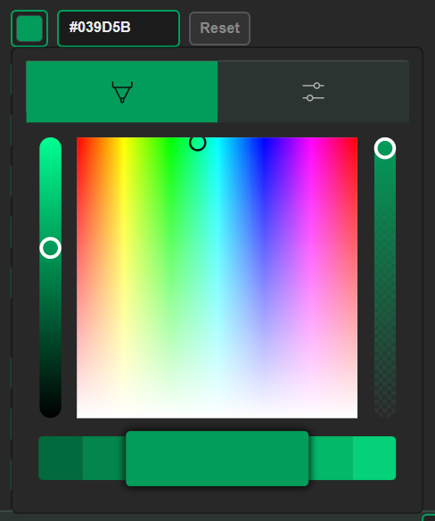
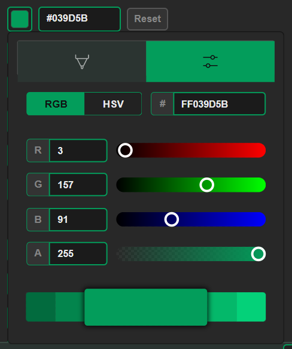

# Colors and themes

The **Colors** category changes the colors of the interface, the canvases and the code editor. Each color has a swatch button, a hex box and a **Reset** button. A change shows at once, with no restart.

There is one built-in theme (dark, green accent). You change it color by color, or import a theme file. When you give **Window** a light color, Studio switches to the light variant of its controls by itself, and back to the dark variant when the color is dark again or reset. Colors that no row covers (for example the text of every control) follow the **Text** colors.

## Controls on each row

| Control | What it does |
| --- | --- |
| Label | The color name from the tables below. |
| Swatch | Shows the color in use. Click it to open the color picker. |
| Text box | Holds `#RRGGBB`, or `#AARRGGBB` when the color is transparent (`AA` is the transparency, `FF` is solid). A valid code applies after you stop typing for about half a second, or when you leave the box. A text that is not a color goes back to the color in use. |
| **Reset** | Removes your color and returns to the theme color. Disabled while the color is not changed. |

Your colors are saved as `colors` in [settings.json](settings-file.md), key to `#RRGGBB` or `#AARRGGBB`. Unknown keys and invalid values are dropped on load.

## The color picker

Clicking a swatch opens the picker. It has two pages:

| Page | What it holds |
| --- | --- |
| Spectrum | A color square, a hue strip and a transparency strip. |
| Components | **RGB** and **HSV** sliders with number boxes, a transparency slider (**A**) and a hex box. |

The color changes while you drag, and Studio applies it when you pause, so the window stays smooth. Closing the picker keeps the color. Colors of text, borders and fills accept transparency. The colors that Studio derives from another one (the hover, pressed and selected fills, the text on the accent) are computed from the solid part of that color.

## Colors by group

Defaults are the theme values.

### Interface

| Label | Key | Default |
| --- | --- | --- |
| **Accent** | `Accent` | `#039D5B` |
| **Quiet border** | `Border.Subtle` | `#3A4A43` |
| **Hover** | `Hover` | `#2F6B50` (follows the accent) |
| **Pressed** | `Pressed` | `#2E4A3D` (follows the accent) |
| **Focus ring** | `Select` | `#ECEDEF` |
| **Selected row** | `Selection.Bg` | `#039D5B` (follows the accent) |

The accent also sets the border, the fills of primary buttons and the dock accents (the line under the chosen tab, the frame of the editor area and the highlight of a splitter). **Hover**, **Pressed** and **Selected row** follow the accent until you pick a color for them. Fills are lightened or darkened until text on them reaches a 4.5:1 contrast.

### Surfaces

| Label | Key | Default |
| --- | --- | --- |
| **Window** | `Bg.Window` | `#282828` |
| **Panel** | `Bg.Surface` | `#222222` |
| **Input field** | `Bg.Sunken` | `#1B1B1B` |
| **Raised area** | `Bg.Raised` | `#2B3431` |
| **Menus and pop-ups** | `Bg.Overlay` | `#282828` (follows **Window** until you choose a color) |

### Text

| Label | Key | Default |
| --- | --- | --- |
| **Text** | `Text.Main` | `#E8E9EB` |
| **Quiet text** | `Text.Muted` | `#B2B8C2` |
| **Text on accent** | `Text.OnAccent` | `#0F0F0F` |
| **Accent text** | `Text.Accent` | `#6DE985` (follows the accent: a lighter shade of it) |

### Disabled controls

| Label | Key | Default |
| --- | --- | --- |
| **Disabled fill** | `Disabled.Bg` | `#333333` |
| **Disabled text** | `Disabled.Text` | `#888888` |
| **Disabled border** | `Disabled.Border` | `#555555` |

### Status

| Label | Key | Default |
| --- | --- | --- |
| **Error** | `Danger` | `#FF9F9F` |
| **Warning** | `Warning` | `#FFB74D` |
| **Success** | `Success` | `#6DE985` |
| **Information** | `Info` | `#5599FF` |

### Canvases

| Label | Key | Default |
| --- | --- | --- |
| **Editor canvas** | `Canvas.Bg` | `#1E1E22` |
| **Preview stage** | `Canvas.Stage` | `#18181C` |
| **Lines and curves** | `Canvas.Line` | `#00BFFF` |
| **Points and views** | `Canvas.Point` | `#FFA500` |
| **Guides** | `Canvas.Guide` | `#00FFFF` |
| **Handles and selection** | `Canvas.Handle` | `#FFFFFF` |
| **Marks and hover** | `Canvas.Hover` | `#FFFF00` |
| **Quiet canvas text** | `Canvas.Muted` | `#808080` |

### Comparison

| Label | Key | Default |
| --- | --- | --- |
| **Comparison: added** | `Diff.Added` | `#2EA043` |
| **Comparison: removed** | `Diff.Removed` | `#F85149` |
| **Comparison: changed** | `Diff.Changed` | `#D29922` |

### Code

| Label | Key | Default |
| --- | --- | --- |
| **Keyword** | `Syntax.Keyword` | `#5599FF` (also colors `true` and `false`) |
| **Function** | `Syntax.Function` | `#6FD3E0` |
| **Variable** | `Syntax.Variable` | `#C3A6FF` |
| **Local variable** | `Syntax.Local` | `#7FE0C0` |
| **Global variable** | `Syntax.Global` | `#E89BFF` |
| **Constant** | `Syntax.Constant` | `#F78FB3` |
| **Asset** | `Syntax.Asset` | `#E6D37A` |
| **Built-in function** | `Syntax.BuiltinFunction` | `#6FD3E0` (follows **Function**) |
| **Built-in variable** | `Syntax.BuiltinVariable` | `#C3A6FF` (follows **Variable**) |
| **Built-in constant** | `Syntax.BuiltinConstant` | `#F78FB3` (follows **Constant**) |
| **String** | `Syntax.String` | `#FFB74D` |
| **Number** | `Syntax.Number` | `#6DE985` |
| **Comment** | `Syntax.Comment` | `#9CA3AF` |
| **Operator** | `Syntax.Operator` | `#E8E9EB` |
| **Preprocessor** | `Syntax.Preprocessor` | `#FF9F9F` |
| **Bracket level 1** | `Syntax.Bracket1` | `#E6D37A` |
| **Bracket level 2** | `Syntax.Bracket2` | `#C3A6FF` |
| **Bracket level 3** | `Syntax.Bracket3` | `#6FD3E0` |

A built-in name (a function, variable or constant that GameMaker provides) has the color of the game's own kind of name until you give it a color of its own. Change **Function** and built-in functions follow, unless **Built-in function** is set.

## Export and import a theme

| Button | What it does |
| --- | --- |
| **Export theme...** | Saves your changed colors to a JSON file. The suggested name is `g3mstudio-theme.json`. |
| **Import theme (G3MStudio, G3M)...** | Reads a theme file and replaces your colors with its colors. |

Accepted files:

- A G3MStudio theme: `{"colors": {"Accent": "#039D5B"}}`. Unknown keys and invalid values are skipped.
- A G3M theme (`theme_config.json`, or a ZIP that holds it at the top or one folder down, up to 1 MB). Only its border color is used, as the accent. An empty color means the default accent.

A file that cannot be used leaves the note "The theme file was not used: {reason}". Your colors stay as they were.

## Advanced overrides

Any token of the theme can be set in `settings.json` under `overrides`, for example `"Danger.Fill": "#CCF44336"` or `"Radius.Window": "10"`. Values are read in the kind of the token: a color (with or without transparency), a number, a corner radius, a thickness or a font family such as `"Font.Code": "Fira Code"`. A token the theme does not have, or a value that does not read, is ignored. Numbers must be from 0 to 1000 (0 to 20 for a thickness, 0 to 50 for a radius). The note in **Advanced** repeats this; see [Advanced settings](advanced.md).

## Restore defaults

**Restore defaults** on **Colors** clears all your colors. Sizes and fonts are in **Appearance**.

## See also

- [Appearance settings](appearance.md)
- [Code editor settings](editor.md)
- [Settings file](settings-file.md)
