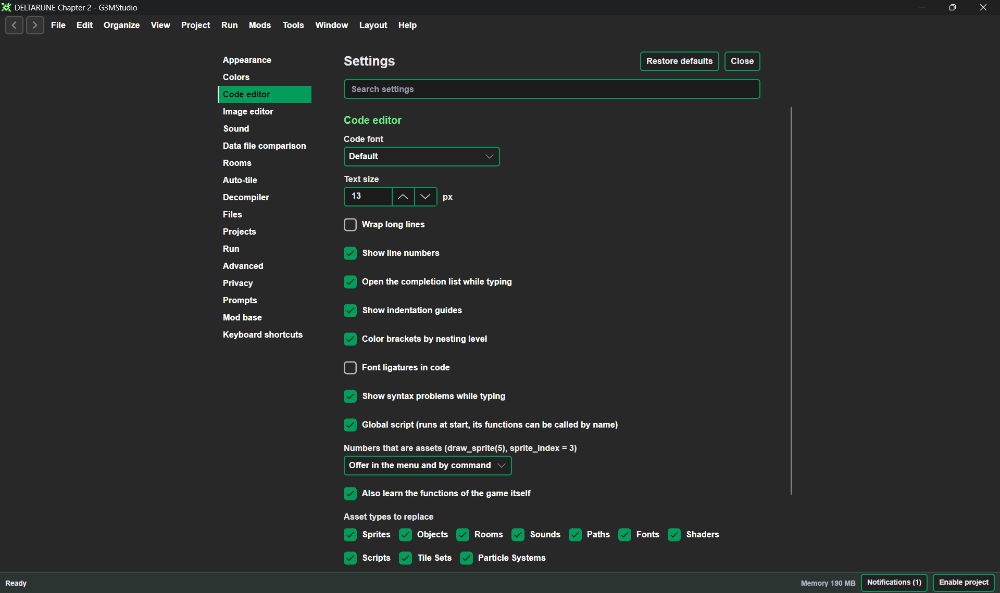

# Code editor settings

The **Code editor** category sets the text size and look of code tabs, completion, live checks and the replacement of asset numbers with names. Every control saves at once and applies to open tabs.

## Controls

| Label | Control | Default | Allowed values | What it does |
| --- | --- | --- | --- | --- |
| **Code font** | List | **Default** | **Default**, system fonts, added fonts | Font of code. **Default** is the theme code font (Noto Sans Mono, Cascadia Mono, Consolas, monospace). `codeFontFamily`. |
| **Text size** | Number | 13 px | 8 to 32 | Size of code text. Also changed by the zoom of the code editor. `codeFontSize`. |
| **Wrap long lines** | Checkbox | Off | On, off | `codeWordWrap`. |
| **Show line numbers** | Checkbox | On | On, off | `codeLineNumbers`. |
| **Open the completion list while typing** | Checkbox | On | On, off | `Ctrl+Space` opens the list either way. `codeAutoComplete`. |
| **Show indentation guides** | Checkbox | On | On, off | Thin vertical lines at each indent level. `codeIndentGuides`. |
| **Color brackets by nesting level** | Checkbox | On | On, off | Uses the three bracket colors. `codeBracketColors`. |
| **Font ligatures in code** | Checkbox | Off | On, off | Applies to code and comparison views. `codeLigatures`. |
| **Show syntax problems while typing** | Checkbox | On | On, off | Squiggles after a pause of about 400 ms. `codeLiveCheck`. |
| **Global script (runs at start, its functions can be called by name)** | Checkbox | On | On, off | The state of the **Global script** box in the New Script window (see [Creating resources](../world/resources.md#new-resource)). On, a new script is a global script (`gml_GlobalScript_name`, as GameMaker makes it). Off, it is a function body (`gml_Script_name`). Changing the box in the window changes this setting. `newScriptGlobal`. |
| **Numbers that are assets (draw_sprite(5), sprite_index = 3)** | List | **Offer in the menu and by command** | **Do nothing**, **Offer in the menu and by command**, **Show names when an entry opens** | See below. `codeAssetNumbers` (`Off`, `Manual`, `Auto`). |
| **Also learn the functions of the game itself** | Checkbox | On | On, off | See below. `codeAssetNumbersGameFunctions`. |
| **Asset types to replace** | Checkboxes | All on | **Sprites**, **Objects**, **Rooms**, **Sounds**, **Paths**, **Fonts**, **Shaders**, **Scripts**, **Tile Sets**, **Particle Systems** | The types whose numbers are replaced. `codeAssetNumberTypes`. |
| **Tab width** | Number | 4 | 2 to 8 | Columns of one tab and one indent step. `codeTabWidth`. |
| **Tooltip delay** | Number | 400 ms | 300 to 3000, step 100 | How long the pointer rests on a name before a tooltip or info card shows. `codeHoverDelayMs`. |
| **Search while typing in the Search panel** | Checkbox | On | On, off | On, the panel searches about 120 ms after the last key. Off, it searches on `Enter` or **Search**. `searchLive`. |
| **Context lines in search results** | Number | 1 | 0 to 3 | Lines shown above and below each match in the Search panel. `searchContextLines`. |
| **Most results listed** | Number | 5000 | 500 to 100000, step 500 | The Search panel stops listing here and shows a **Show more** row. `searchMaxResults`. |

Code colors, including the built-in function, variable and constant colors, are on [Colors and themes](colors-and-themes.md).

## Numbers that are assets

GameMaker stores a sprite, object or sound as a number. In decompiled code that gives `draw_sprite(5, 0, x, y)` instead of `draw_sprite(spr_player, 0, x, y)`.

| Mode | Behavior |
| --- | --- |
| **Do nothing** | No replacement is offered. |
| **Offer in the menu and by command** | The code context menu offers **Replace Numbers with Asset Names**, and the command of that name is available. The menu on a single number offers to replace only that one. Text is changed only when you choose it. |
| **Show names when an entry opens** | A decompiled entry shows asset names in place of the numbers when it opens. |

**Also learn the functions of the game itself** reads the calls of the game that already pass an asset name, so `scr_play(12)` becomes `scr_play(snd_item)`.
The command **Replace Numbers with Asset Names** works on the selection or the whole entry. Details and the whole-project run are on [Asset numbers](../code/asset-numbers.md).

## Restore defaults

Resets every control on this page, including the asset number options.

## See also

- [Code editor](../code/code-editor.md)
- [Asset numbers](../code/asset-numbers.md)
- [Colors and themes](colors-and-themes.md)
- [Decompiler settings](decompiler.md)
