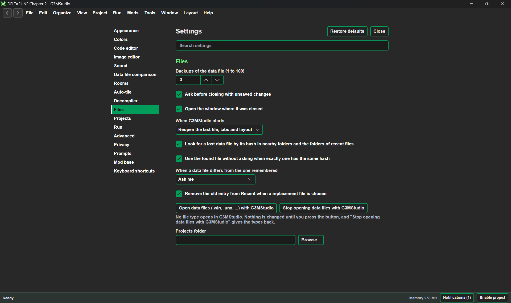

# Files and startup settings

The **Files** category covers backups, closing with unsaved changes, the window position, what happens at start, how G3MStudio finds a data file that moved, the file type association and the projects folder.

## Controls

| Label | Control | Default | Allowed values | Saved as |
| --- | --- | --- | --- | --- |
| **Backups of the data file (1 to 100)** | Number | 3 | 1 to 100 | `backupCount` |
| **Ask before closing with unsaved changes** | Checkbox | On | On, off | `askOnClose`. Off: closing keeps the changes in the journal without asking. |
| **Open the window where it was closed** | Checkbox | On | On, off | `rememberWindow`. A window mostly off screen is not restored. |
| **When G3MStudio starts** | List | **Reopen the last file, tabs and layout** | **Reopen the last file, tabs and layout**, **Show Home**, **Ask me** | `startup`: `Restore`, `Home`, `Ask`. A restore that fails goes to Home. |
| **Look for a lost data file by its hash in nearby folders and the folders of recent files** | Checkbox | On | On, off | `lostFileSearch` |
| **Use the found file without asking when exactly one has the same hash** | Checkbox | On | On, off | `lostFileAutoUse` |
| **When a data file differs from the one remembered** | List | **Ask me** | **Ask me**, **Open it and keep the saved layout**, **Open it with a fresh layout**, **Do not open it** | `hashMismatch`: `Ask`, `KeepLayout`, `FreshLayout`, `Refuse` |
| **Remove the old entry from Recent when a replacement file is chosen** | Checkbox | On | On, off | `lostFileForgetOld` |
| **Open data files (.win, .unx, ...) with G3MStudio** | Button | | | Registers the file types. |
| **Stop opening data files with G3MStudio** | Button | | | Removes the registration. |
| **Projects folder** | Text and **Browse...** | the remembered folder | Any folder | Where new projects are created. Stored with the project list, not in `settings.json`. |

## Backups

Each backup is a full copy of the data file. The tip warns: 100 backups of a 500 MB file take 50 GB, and every save renames each backup once. See [Saving](../projects/saving.md).

## File association

The text under the buttons names the file types that open in G3MStudio now, or says no type opens there. Nothing changes until you press a button, and the second button gives the types back. On a system that cannot set file types it reads "File types cannot be set on this system." and both buttons are disabled. A failure shows "The links could not be registered: {reason}".

## Lost files

The three lost-file options work together when a remembered data file is gone. See [Lost file](../projects/lost-file.md).

## Restore defaults

Resets **Backups of the data file (1 to 100)**, **Ask before closing with unsaved changes** and **Open the window where it was closed**. It leaves the start and lost-file rows and the folder alone.

## See also

- [Lost file](../projects/lost-file.md)
- [Saving](../projects/saving.md)
- [Opening files](../getting-started/opening-files.md)
- [Default values](defaults-table.md)
