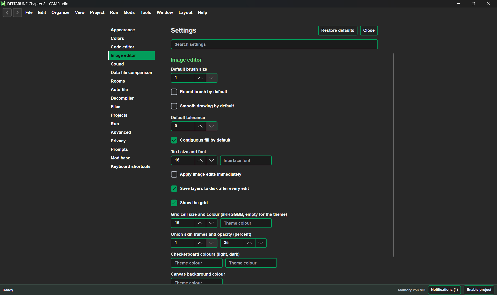

# Image editor settings

The **Image editor** category sets the starting values of the image editor tools and the colors behind pictures. They are read when an editor opens. Text boxes for colors save when you leave the box.

Colors are written `#RRGGBB` or `#RRGGBBAA`. An empty box keeps the theme color. A value that does not parse is saved as empty.

## Controls

| Label | Control | Default | Range | Saved as |
| --- | --- | --- | --- | --- |
| **Default brush size** | Number | 1 | 1 to 256 | `image.brushSize` |
| **Round brush by default** | Checkbox | Off | | `image.brushRound` |
| **Smooth drawing by default** | Checkbox | Off | | `image.smooth` (anti-aliased brush, lines and shapes) |
| **Default tolerance** | Number | 0 | 0 to 255 | `image.tolerance` (fill, replace, remove and magic wand) |
| **Contiguous fill by default** | Checkbox | On | | `image.contiguous` |
| **Text size and font** | Number and text | 16 and empty (**Interface font**) | 4 to 256 | `image.textSize`, `image.textFont` |
| **Apply image edits immediately** | Checkbox | Off | | `image.applyImmediately`. On: every edit goes straight into the workspace. Off: edits stay in the editor until Apply writes them as one step. |
| **Save layers to disk after every edit** | Checkbox | On | | `image.layerAutosave`. Off: layer stacks are written when the file closes. |
| **Show the grid** | Checkbox | On | | `image.showGrid` |
| **Grid cell size and colour (#RRGGBB, empty for the theme)** | Number and text | 16 and empty (**Theme colour**) | 0 to 1024 | `image.gridCell` (0 turns the heavy lines off), `image.gridColour` |
| **Onion skin frames and opacity (percent)** | Two numbers | 1 and 35 | 1 to 8 frames, 5 to 100 | `image.onionFrames`, `image.onionOpacity` |
| **Checkerboard colours (light, dark)** | Two texts | empty | | `image.checkerLight`, `image.checkerDark`. Also colors the grid behind pictures in resource tabs. |
| **Canvas background colour** | Text | empty | | `image.canvasBackground` |
| **Handle size (pixels)** | Number | 3 | 1 to 12 | `image.handleSize` (control points of polygons, curves and the lasso) |
| **Pan the view with** | List | Middle button | Middle, back or forward button | `image.sheetPanButton` (`Mouse3`, `Mouse4` or `Mouse5`). The button that drags the view in the image editor, the room editor, the path editor, a texture page, a page item picture, a tile palette and a sprite canvas. Over those views the button only pans, even when a shortcut uses it. |

The keys sit under `image` in [settings.json](settings-file.md).

## Values kept from dialogs

The same `image` object also stores what the Resize and Import Sheet dialogs held last. They have no control on the Settings page: `fitGrow` (true), `fitNewPage` (true), `fitMaxSide` (0 means the largest page of the file, otherwise 64 up to the page limit), `resizeScale` (true), `resizeSmooth` (false), `resizeKeep` (true), `resizePercent` (false), `resizeAnchor` (0 to 8, default 0), `resizeFill` (0 clear, 1 black, 2 white; default 0), `resizeAllKey` (`Alt`), `resizeBox` (true), `resizePercentW` and `resizePercentH` (100, range 1 to 4096), `sheetBySize` (false).

## Restore defaults

Resets the whole `image` object, including the dialog values above.

## See also

- [Sprite editor](../graphics/sprite-editor.md)
- [Colors and themes](colors-and-themes.md)
- [Default values](defaults-table.md)
