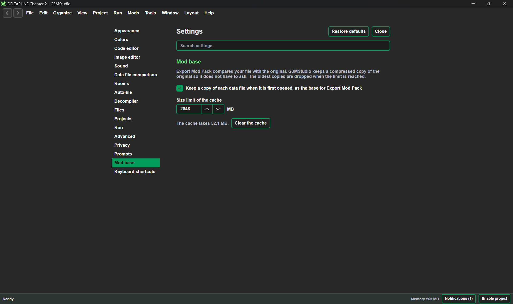

# Mod base

The **Mod base** category controls the cache of original data files that **Export Mod Pack** compares against. The note reads: "Export Mod Pack compares your file with the original. G3MStudio keeps a compressed copy of the original so it does not have to ask. The oldest copies are dropped when the limit is reached."

## Controls

| Label | Control | Default | Range | Saved as |
| --- | --- | --- | --- | --- |
| **Keep a copy of each data file when it is first opened, as the base for Export Mod Pack** | Checkbox | On | | `modBaseEnabled` |
| **Size limit of the cache** | Number | 2048 MB | 64 to 1048576, step 256 | `modBaseMaxMb` |
| (text) | Label | | | "The cache takes {size} MB." |
| **Clear the cache** | Button | | | Empties the cache. |

Lowering the limit frees space at once, oldest copies first. The number box runs from 64 to 1048576 MB in steps of 256.

## How the cache works

- One copy is kept per data file path. The first open wins: a later open of the same path does not replace the copy.
- A copy is gzip compressed. The files are `modbase/index.json` and `modbase/<hash>.gz` in the [data folder](../getting-started/user-data.md).
- A copy that does not fit under the limit on its own is not kept. The message "{name} is larger than the cache limit, so no copy was kept." shows, and Export Mod Pack then asks you for the original file.
- When the cache is full, the oldest copies go first to make room.
- With the checkbox off, no copies are made and Export Mod Pack ignores the stored ones. It asks for the original file each time. Stored copies stay until you clear them.
- When Export Mod Pack has to ask for the original, the file you pick is checked against the stored hash and, with the checkbox on, stored as the new copy.
- If `index.json` cannot be read, G3MStudio reports "The mod base index cannot be read. Clear the cache in the settings." Press **Clear the cache** to fix it.

The **Mods** menu has the same actions as commands: **Remember This File as the Mod Base** and **Clear the Mod Base Cache**.

## Example: keep the original of a game

1. Open the untouched `data.win` of the game once, with **Keep a copy of each data file...** on. The original is stored.
2. Edit and save as usual. The copy stays the original.
3. Run **Export Mod Pack...**. G3MStudio compares your file with the stored copy and does not ask for the original.
4. After the game updates, open the new `data.win` and use **Remember This File as the Mod Base**, so later packs compare against the new version. If the file changed on disk, Export Mod Pack asks whether to use the remembered original or the changed file.

## Messages

| Message | When |
| --- | --- |
| The mod base cache is empty. | After **Clear the cache**. |
| The cache could not be cleared. Some files are in use. | A file of the cache is locked. |
| {name} is larger than the cache limit, so no copy was kept. | The data file is bigger than the limit. |
| The file changed since it was remembered. Use the remembered original, or remember this file as the new base? | A data file differs from its stored original. Buttons: **Use the remembered original**, **Remember this file as the new base**. |
| {name} is now the mod base. | A new base was remembered. |
| The saved copy of the original is missing or damaged. Choose the original file. | The cache entry is gone. |
| That file does not match the saved original (the hash differs). Nothing was exported. | The chosen original has another hash. |

## Restore defaults

Resets both options. It does not clear the cache.

## See also

- [Mod packs](../projects/mod-packs.md)
- [Mods](../projects/mods.md)
- [Default values](defaults-table.md)
