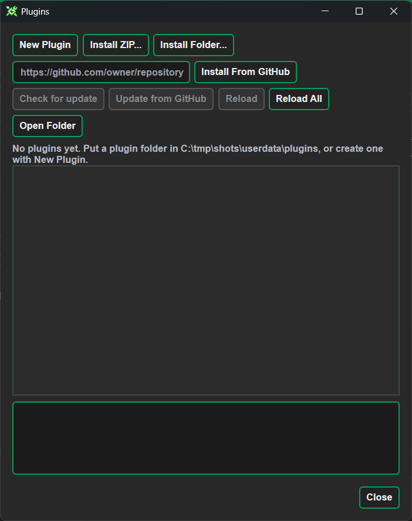

# Plugins

Plugins add commands, panels, editor views, code hints and code actions to G3MStudio. A plugin is a folder of C# source files that G3MStudio compiles and runs itself. The two global switches are in [Advanced settings](advanced.md); this page covers the **Plugins** window and the plugin folder.

Plugins have full access to your computer, like scripts. Install only plugins you trust. **Permissions** in a plugin are text it declares about itself. G3MStudio does not enforce them. To write one, see [Writing a plugin](../reference/plugin-api.md).

## Open the window

**Tools** > **Plugins...** opens the **Plugins** window (command `tools.plugins`). Once a plugin adds commands, a **Plugins** menu appears in the menu bar before **Window** and **Help**. It lists those commands by title.

## The window

| Control | What it does |
| --- | --- |
| **New Plugin** | Creates a plugin named "New Plugin" (then "New Plugin 2" and so on) with one command, **New Plugin: Say Hello**. The folder is the name in lower case without spaces (`newplugin`, `newplugin2`). The list is read again. |
| **Install ZIP...** | Installs a plugin from a ZIP file. `plugin.json` must be in the ZIP root, or the whole plugin must sit in one top folder (a GitHub download does). Otherwise: "The ZIP has no plugin.json in its root." |
| **Install Folder...** | Installs a plugin from a folder. A folder that is already inside the plugins folder is refused: "The plugin folder is inside the plugins folder. Install it from somewhere else." |
| **GitHub repository address** box and **Install From GitHub** | Downloads the default branch of a public repository as a ZIP and installs it. Only `https://github.com/owner/repository` is accepted (a `.git` ending and extra path parts are ignored). Another address gives "Use an address like https://github.com/owner/repository." A download over 50 MB stops with "The plugin is larger than 50 MB." |
| **Check for update** | Asks GitHub for the latest commit of the plugin's repository and compares it with the installed one. Messages: "A newer version is available. Use Update from GitHub." or "The plugin is up to date." |
| **Update from GitHub** | Installs the origin again. "This plugin was not installed from GitHub, so there is nothing to update from." when there is none. |
| **Reload** | Stops, reads and starts the selected plugin. |
| **Reload All** | Reads every plugin folder again. |
| **Open Folder** | Opens the selected plugin folder, or the plugins folder when none is selected. |
| List | One row per plugin: name and version, the state, and an **On** checkbox. States: **Active**, **Turned off**, **Failed to start**. |
| Details box | Name, version, description, folder, homepage, **Permissions**, **Error** and the plugin log. The log holds what the plugin wrote and every error it threw. It lives in memory only and is empty after a restart. |
| **Options** | The options the selected plugin declared (checkbox, text, number or list). Saved at once. |

Messages of an install or update, and the result of **Check for update**, show in the details box. A failure starts with "Error:". **Check for update**, **Update from GitHub** and **Reload** stay gray until you select a row. The **Options** area shows only when the selected plugin declared options.

When the list is empty it reads "No plugins yet. Put a plugin folder in {folder}, or create one with New Plugin."

Install asks first: "Install '{name}' {version}?" with source, authors and the permissions it says it needs. The question cannot be silenced, and nothing is copied until you accept. The plugin id may hold only letters, digits, dots, dashes and underscores (not dots alone). Installing a plugin with the same id replaces it. The new files are built in a `~new-<id>` folder beside the old plugin and swapped in at the end, so a failed update keeps the old plugin. Folders that start with `~` are install work files and are not listed.

A plugin installed from GitHub gets a `.origin` file in its folder with the address and the commit id. **Check for update** and **Update from GitHub** use it.

## Example: install and try a plugin

1. **Tools** > **Plugins...**.
2. Paste `https://github.com/owner/repository` into the address box and press **Install From GitHub**.
3. Read the question and the permissions, then accept.
4. The plugin appears in the list as **Active**. Its commands are in the **Plugins** menu.
5. Select it. Change its values under **Options**. They are saved at once.
6. To stop it, clear its **On** box. The state becomes **Turned off** and stays off after a restart.



## Where plugins live

Plugins are in the `plugins` folder of the [user data folder](../getting-started/user-data.md). The ids of plugins you switched off are in `plugins.json` in the data folder. Compiled plugins are cached in `plugin-cache` (a file `<id>-<hash>.dll`, rebuilt when a source file, a library or G3MStudio itself changes). Options of a plugin are kept in `plugin-settings/<plugin id>.json` in the data folder, so they survive a reload and an update.

## Plugin folder layout

```text
plugins/
  my-plugin/
    plugin.json
    src/
      Main.cs
    lib/            optional, extra .dll files
```

`plugin.json` fields:

| Field | Required | Default | Meaning |
| --- | --- | --- | --- |
| `id` | yes | | Unique id. |
| `name` | yes | | Shown name. |
| `version` | yes | | Shown version. |
| `description` | no | empty | |
| `entry` | no | `src/Main.cs` | File with the plugin class. All `.cs` files under `src` are compiled together. |
| `authors` | no | empty list | |
| `permissions` | no | empty list | Shown to you at install. Text only. |
| `homepage` | no | empty | |

Comments and trailing commas are allowed in the file. A folder with a manifest that lacks `id`, `name` or `version` is listed as **Failed to start** under its folder name, with "plugin.json needs id, name and version." A `plugin.json` that sits directly in the plugins folder gives the warning "plugin.json sits directly in the plugins folder. Put the plugin files in their own folder there, or use Plugins > Install ZIP." A plugin with no `.cs` file under `src` fails with "The plugin has no .cs files under src."

The plugin class implements `IStudioPlugin` (`Activate` and `Deactivate`). `Activate` gets a context that can add commands, panels, editors for a resource type, settings, event handlers, code hints (gray notes after a line) and code actions (entries in the code context menu), read and replace code, and write to the log. Everything a plugin adds goes away when it is deactivated.

## Switches in Settings > Advanced

| Label | Default | Effect |
| --- | --- | --- |
| **Run plugins** | On | Off stops every plugin; the list shows them as **Turned off**. Turning it on again starts the ones that were enabled. |
| **Reload a plugin when its files are saved** | On | G3MStudio watches the plugins folder. When the files of a plugin stay unchanged for half a second after a save, that plugin is recompiled and restarted. A plugin you switched off is not reloaded. |

If the system cannot give a folder watcher (for example the Linux inotify limit is reached), plugins run without this reload. Use **Reload**. The compile runs in the background, so the window keeps responding.

## Failures

A plugin that fails to compile or start is turned off with its error. The notice reads "'{name}' failed to start and was turned off: {error}". A plugin that throws in an editor view, hint provider or code action is logged and skipped. Nothing a plugin does stops the program.

## See also

- [Writing a plugin](../reference/plugin-api.md)
- [Advanced settings](advanced.md)
- [User data](../getting-started/user-data.md)
- [Code editor](../code/code-editor.md)
