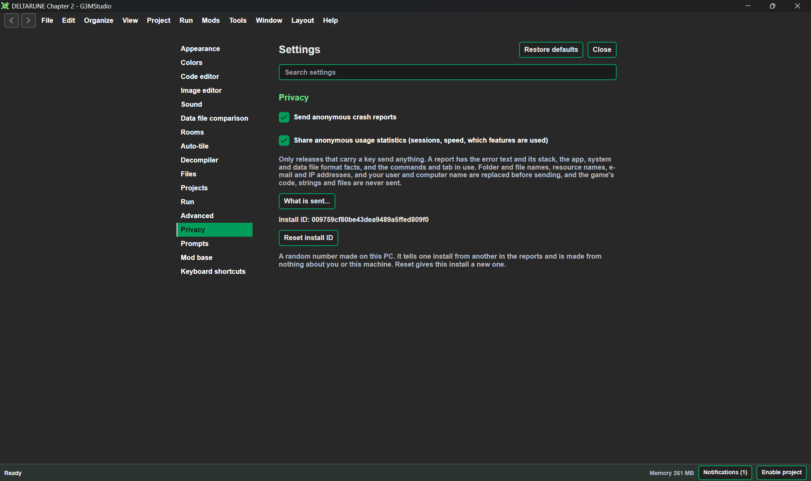

# Privacy and crash reports

The **Privacy** category controls the anonymous crash reports and usage statistics. Both are on by default, both can be switched off here or in the welcome window, and nothing is sent before the welcome window is closed.

## Controls

| Label | Control | Default | What it does |
| --- | --- | --- | --- |
| **Send anonymous crash reports** | Checkbox | On | Sends error reports. `crashReports`. |
| **Share anonymous usage statistics (sessions, speed, which features are used)** | Checkbox | On | Sends usage summaries. Disabled while crash reports are off. `usageStats`. |
| **What is sent...** | Button | | Opens the window **What is sent**. |
| **Install ID** | Selectable text | random | A random number made on this PC. `installId`. |
| **Reset install ID** | Button | | Gives this install a new random ID. |

The note under the checkboxes reads: "Only releases that carry a key send anything." A build without a reporting key sends nothing, whatever the switches say.

## Rules

- Nothing is sent until the welcome window has been shown and closed (`onboardingDone`).
- Usage statistics are sent only while crash reports are on. With crash reports off, nothing is sent. With only usage statistics off, only errors and crash sessions are sent.
- A settings file from before usage statistics existed, written by someone who had already finished the welcome window, is read as usage statistics off.
- Switching reports off also deletes the reports still waiting in the local cache folder.
- A failure inside the reporting never stops the app.

## What is sent

**Crash reports:** the error text and its stack, the versions of the app and G3MLib, the system (Windows version, processor type, memory size class), the commands and the kind of tab in use, a few settings (language, theme, scale) and the format facts of the data file (game version, size class). Sessions that start, end or crash.

**Usage statistics:** how long a session lasts, how fast opening, saving and tabs are, how many resources a file has (as a size class), which commands and editors are used and how often (one summary per session), the update check result, and notes about start-up and hangs.

**Never sent:** folder, file, user and computer names. Names of resources, objects, sprites and rooms. The game's code, texts, pictures and sounds. Anything you type, except feedback you choose to send. E-mail and IP addresses, keys. The only identifier is a random install ID that you can reset.

Before sending, folder and file names, resource names, e-mail and IP addresses, and your user and computer name are replaced. The report carries no machine name and no personal data.

## When the window stops responding

G3MStudio watches its own window from a second thread. When the window does not answer for 10 seconds, the thread writes `hang-<time>-<id>.txt` to the `crashes` folder of the [data folder](../getting-started/user-data.md). The file says what the window was doing, whether it was busy or waiting, the memory in use and the last few actions by kind (a tab opened, a file opened, never a name). If the window answers again, a last line says when. The newest 10 files are kept. The file is written whether or not reports are on. With crash reports on, one anonymous problem report goes out as well. The window is never touched: the watcher only reads.

A pause of at least a quarter of a second that ends by itself counts as a slow moment. With usage statistics on, at most one such note goes out every 30 seconds, with its length and the kind of the last action.

## Send feedback

**Help** > **Send Feedback...** opens the **Send Feedback** window.

| Control | Detail |
| --- | --- |
| **Your message** | Up to 4000 characters. **Send** is enabled once the box has text and reporting is on. |
| **Contact (optional, sent only if you fill it in)** | Up to 200 characters. |
| **Include diagnostics (versions, system facts, the random install ID and the recent steps)** | Checked by default. |
| **Send** | Sends the message. On success: "Feedback sent. Thank you." On failure: "The feedback could not be sent." |

The window lists what goes out: your message with paths, e-mail and IP addresses removed, the contact if you typed one, and the diagnostics if the box is checked. Never sent: files, screenshots, or names of your folders, resources and computer.

With reporting off the window says "Reporting is off. Turn on crash reports in Settings > Privacy to send feedback, or use Help > Report a Problem." **Report a Problem...** opens the issues page of the project on GitHub. **Copy Diagnostics** copies the facts to the clipboard.

## Restore defaults

Sets both checkboxes back to on. It keeps the install ID.

## See also

- [Welcome window](../getting-started/first-launch.md)
- [Updating](../getting-started/updating.md)
- [Troubleshooting](../reference/troubleshooting.md)
