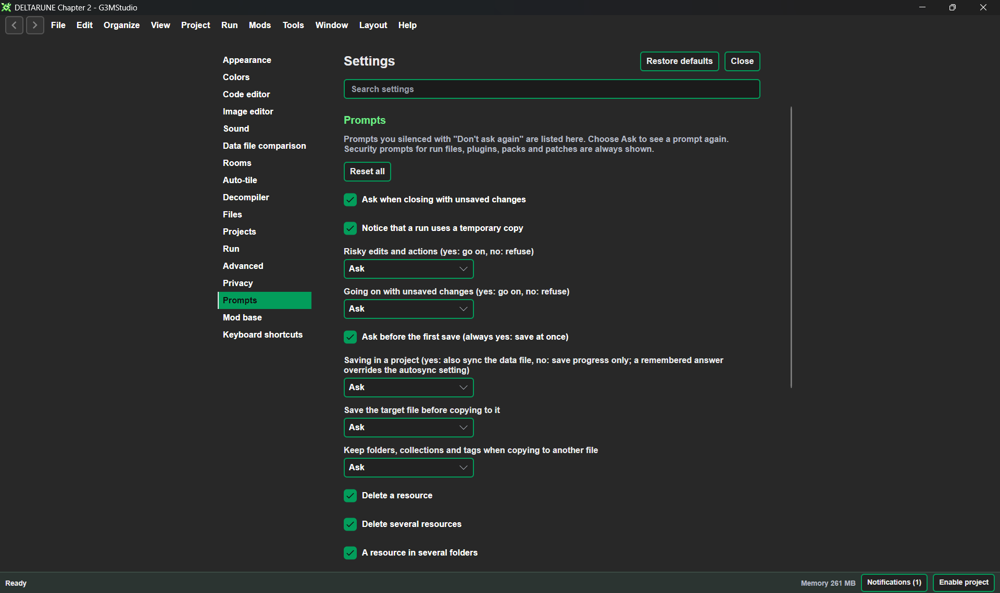

# Prompts

The **Prompts** category lists every question that G3MStudio lets you silence with **Don't ask again**, with the answer used now. Use it to bring a silenced question back.

The note reads: "Prompts you silenced with "Don't ask again" are listed here. Choose Ask to see a prompt again. Security prompts for run files, plugins, packs and patches are always shown."

## Controls

**Reset all** sets every prompt back to asking. The command **Ask Again for All Prompts** (`settings.resetPrompts`) does the same from the command palette, and the message "All prompts ask again." confirms it.

Each prompt is one row. A prompt that can be answered yes or no is a list with **Ask**, **Always yes**, **Always no**. A prompt with two real actions, or a notice, is a checkbox: checked asks every time, unchecked answers yes.

| Row | Control | Default | Choices |
| --- | --- | --- | --- |
| **Ask when closing with unsaved changes** | Checkbox | Asks | Unchecked keeps changes in the journal when closing. Same as `askOnClose`. |
| **Notice that a run uses a temporary copy** | Checkbox | Asks | Unchecked runs without the notice. Same as `warnTempRun`. |
| **Risky edits and actions (yes: go on, no: refuse)** | List | **Ask** | **Ask**, **Always yes**, **Always no**. Same as the two risky-action options in [Advanced settings](advanced.md). |
| **Going on with unsaved changes (yes: go on, no: refuse)** | List | **Ask** | all three |
| **Ask before the first save (always yes: save at once)** | Checkbox | Asks | |
| **Saving in a project (yes: also sync the data file, no: save progress only; a remembered answer overrides the autosync setting)** | List | **Ask** | all three |
| **Save the target file before copying to it** | List | **Ask** | all three |
| **Keep folders, collections and tags when copying to another file** | List | **Ask** | all three |
| **Delete a resource** | Checkbox | Asks | |
| **Delete several resources** | Checkbox | Asks | |
| **A resource in several folders** | Checkbox | Asks | |
| **Replace a font** | List | **Ask** | all three |
| **Repack texture pages** | List | **Ask** | all three |
| **Import resources into the open file** | List | **Ask** | all three |
| **Revert to the saved file** | List | **Ask** | all three |
| **Turn the GameMaker debugger flag on** | List | **Ask** | all three |
| **Move run options into G3MStudio's folder** | List | **Ask** | all three |
| **Copying a timeline moment: always copy the code** | Checkbox | Asks | Unchecked: always copy. |
| **Copying a timeline moment: always share the code entries** | Checkbox | Asks | Unchecked: always share. |

Remembered answers are saved as `prompts` in [settings.json](settings-file.md), prompt id to `Yes` or `No`. A stored **No** for a prompt that cannot say no reads as asking. Unknown ids are dropped on load.

The ids are `closeUnsaved`, `tempRunWarning`, `riskyAction`, `unsavedChanges`, `saveFirst`, `saveProject`, `copyToSave`, `copyKeepOrganize`, `deleteResource`, `deleteMany`, `multiFolder`, `replaceFont`, `repackTextures`, `importResources`, `revertToSaved`, `debuggerFlag`, `migrateRunOptions`, `timelineCopyCode`, `timelineCopyShare`.

## Questions that cannot be turned off

Security prompts always appear: run options found next to a data file, plugins, mod packs, patches, scripts, downloads and updates.

## Restore defaults

Same as **Reset all**.

## See also

- [Advanced settings](advanced.md)
- [Files and startup settings](files.md)
- [Run settings](run.md)
