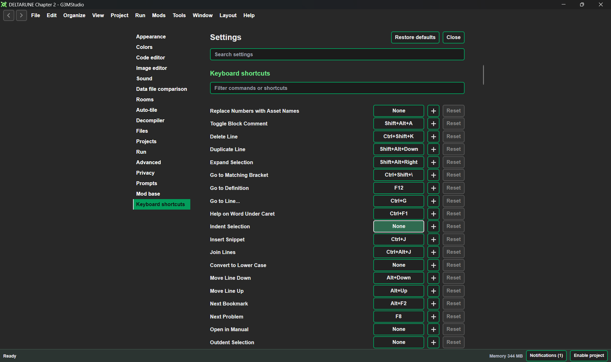

# Keyboard shortcuts and mouse gestures

The **Keyboard shortcuts** category lists every command with its keys. You can change the main key of a command, add extra keys (aliases), use mouse buttons as shortcuts, and reset a command to its default.

## The list

Each row shows the command name on the left and its gestures on the right. Rows are sorted by command id.

| Control | What it does |
| --- | --- |
| **Filter commands or shortcuts** | Shows only rows whose command name, command id or gestures contain the text. The **Search settings** box of the page narrows the list the same way. |
| Primary button | Shows the main gesture, or **None**. Click it to change it. |
| Alias buttons | One button for each extra gesture. Click one to change it. |
| Add button (a plus icon, tip **Add another shortcut**) | Adds an alias. |
| **Reset** | Returns the command to its default gesture and aliases. Disabled while the command is at its default. |

## Change a shortcut

1. Click the primary button, an alias button or the plus button of the command.
2. The button reads **Press the keys or a mouse button...**.
3. Press the new key combination, or a mouse button (see below).
4. The new gesture is saved and applies at once.

While a button waits, other commands do not run.

| Key while waiting | Result |
| --- | --- |
| `Esc` | Cancels. |
| `Backspace` or `Delete` (no modifier) | Clears the slot: the primary becomes **None**, an alias is removed. |
| Modifiers alone (`Ctrl`, `Alt`, `Shift`, `Win`) | Ignored. Keep holding them and press a key. |
| Any other key | Saved with the modifiers held, written `Ctrl+Alt+Shift+Key` in that order. |

On macOS, `Ctrl` in a stored gesture stands for `Cmd`, and the page shows **Cmd**. Punctuation keys show as their character, and keypad keys as **Num 5** and so on.

## Mouse buttons as shortcuts

A mouse button can be a gesture. The names are `Mouse1` (left), `Mouse2` (right), `Mouse3` (middle), `Mouse4` (back) and `Mouse5` (forward), with `Ctrl`, `Alt` or `Shift` in front. The page shows them as **Mouse 3**, **Ctrl+Mouse 4** and so on.

- A bare left or right click stays a click. `Mouse1` and `Mouse2` count as a gesture only with a modifier held, so the button you click to start the capture is not taken.
- Only a real mouse makes a gesture. A touch tap or a pen is not read as a mouse button.
- When a button is pressed, the command with that gesture runs. If several commands share it, the order is: a gesture you chose as the primary of a command, then any primary, then the command id.
- The back and forward buttons (`Mouse4`, `Mouse5`) always step through tabs (`tabs.back`, `tabs.forward`) unless some command claims that button.

## Conflicts

Two commands may hold the same gesture. The editor does not block it. After the change it shows the note "{shortcut} is also used by: {commands}."

When the main window applies saved shortcuts it also warns once per pair when a key you set takes over another command:

- "{shortcut} is set for {user} and is also the default of {other}. {user} runs on that key."
- "{shortcut} is set for {user} and is also used by {other}. {user} runs on that key."

A key press runs the command in this order: a key you chose as a primary, then any primary, then an alias, then the command id.

## Reset

- **Reset** on a row resets that command.
- **Restore defaults** on the category clears all your primary shortcuts (`keybindings`). Aliases you added are kept.

## What is saved

Changes are saved in [settings.json](settings-file.md):

| Key | Meaning |
| --- | --- |
| `shortcuts` | Command id to the primary gesture. An empty text means the command has none. A command at its default has no entry. |
| `shortcutAliases` | Command id to the list of extra gestures. A listed command uses exactly this list, an empty list means none. A command at its default aliases has no entry. |

A hand-written alias that is not a key gesture or a mouse gesture (for example `Ctrl+Foo`) is ignored.

## Default commands

Defaults are set by the command list, not by this page. Some of the ones tied to the Settings page and window:

| Command | Name | Default |
| --- | --- | --- |
| `settings.open` | **Settings** | `Ctrl+,` |
| `view.zoomIn` | **Zoom In** | `Ctrl++` |
| `view.zoomOut` | **Zoom Out** | `Ctrl+-` |
| `view.zoomReset` | **Reset Zoom** | `Ctrl+0` |
| `tabs.back` | previous resource | `Alt+Left`, and `Mouse4` when no command claims it |
| `tabs.forward` | next resource | `Alt+Right`, and `Mouse5` when no command claims it |
| `go.object` | **Go to Object** | `Ctrl+F12`. Works while one instance is selected in a room. |
| `go.sprite` | **Go to Sprite** | `Alt+Shift+F12`. Works while a selected instance, layer, object tab or object row shows a sprite or tile set. |
| `edit.findUsages` | **Find Usages** | `Shift+F12` |
| `run.game` | **Run Game** | `F5` |
| `run.restart` | **Restart Game** | `Ctrl+F5` |
| `run.stop` | **Stop Game** | `Shift+F5` |
| `room.play` | **Play This Room** | `Ctrl+Shift+F5` |

The full list is in [Command reference](../interface/command-reference.md).

## See also

- [Command reference](../interface/command-reference.md)
- [Command palette and Go to](../interface/command-palette-and-go-to.md)
- [Editor shortcuts](../code/editor-shortcuts.md)
- [Settings file](settings-file.md)
