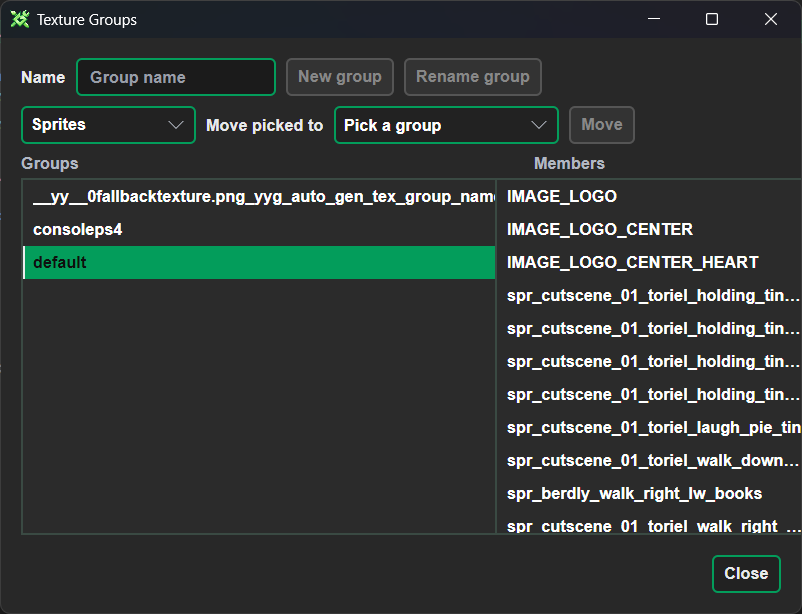

# Texture and audio groups

Groups decide which pictures or sounds are loaded together. This page covers the Groups window, which edits texture groups and audio groups.

## Open it

**Tools** > **Texture Groups...** opens the window `Texture Groups`. **Tools** > **Audio Groups...** opens `Audio Groups`. Both need an open data file. Some data files have no groups; the list then reads `This data file has no groups.`

## Window

Two lists: **Groups** on the left and **Members** on the right. Selecting a group lists its members, or `This group has no members of this kind.` while none is selected: `Pick a group to see its members.`

| Control | What it does |
| --- | --- |
| **Kind** (texture groups only) | Which members to list: **Sprites**, **Fonts** or **Tile Sets**. A texture group holds all three. |
| **Move picked to** | Box that picks the target group. |
| **Move** | Moves the members you selected (the list takes several) to the target group. Notice: `Moved {count} to {group}.` Disabled with `Pick a target group and at least one member first.` until both are set. |
| **Name** box with **New group** | Creates a group with that name. Enter in the box does the same. Notice: `Group {name} created.` Disabled with `Type a group name first.` |
| **Rename group** | Renames the selected group to the typed name. Notice: `Group renamed to {name}.` Disabled with `Pick a group in the list first.` when none is selected. |

For audio groups the members are sounds. Each change is one undo step, and the window follows undo and redo.

### Unusual names

A name that is not letters, digits and underscores (not starting with a digit) asks `Use this name?`: `'{name}' is not a plain name (letters, digits and underscores, not starting with a digit). GML code cannot use it, and other tools may fail on it. Undo removes it until you save.` The Settings risk option can allow or refuse such names without asking.

## Move sprites to a new texture group

1. Choose **Tools** > **Texture Groups...**.
2. Type `ui` in the name box and press **New group**. The notice is `Group ui created.`
3. Pick the group the sprites are in. Under **Kind** choose **Sprites**.
4. Select the sprites in **Members**. The list takes several.
5. Pick `ui` in **Move picked to** and press **Move**. The notice is `Moved {count} to ui.`
6. Save the data file.

Sounds work the same way in **Tools** > **Audio Groups...**.

## Other ways to change a group

- **Organize** > **Move to Texture Group...** and **Move to Audio Group...** move selected resources from the Explorer.
- The group of a single resource is a field in its [property list](property-grid.md) (for a sound, **Audio Group**).

## See also

- [Resource management](resources.md)
- [Property list](property-grid.md)
- [Sounds and audio groups](../audio/README.md)
