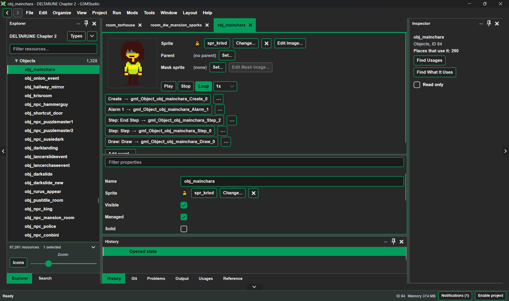
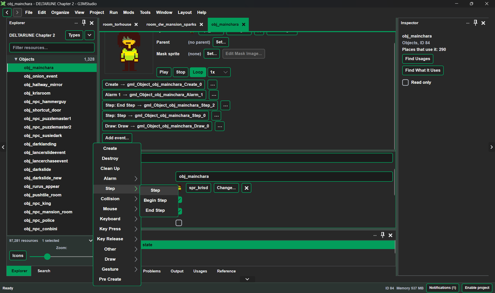

# Objects and events

An object is a kind of game entity, such as `obj_player`. This page covers the object tab: its links, its events and its physics shape vertices.

## Object tab

The tab has three parts above the [property list](property-grid.md): the links with a sprite preview, the event list, and the physics vertices.

### Links

Three rows: **Sprite**, **Parent** and **Mask sprite**. Each row shows a small picture, the target as a link (click to open it), **Set...** or **Change...** (opens the searchable picker), and a cross (**Clear the link**). With no target the row shows `(none)`, or `(no parent)` for the parent.

- **Edit Image...** on the Sprite row opens the sprite picture in the image editor. **Edit Mask Image...** on the Mask sprite row opens the mask sprite. When the object has no sprite the button is disabled with `This object has no sprite with frames to edit. Set one first.`
- Setting the parent to the object itself or to one of its children is refused: `{parent} is {object} or one of its children, so it cannot be the parent.`
- A locked resource disables the buttons with `This entry is locked. Unlock it to change the link.`
- **Go to Sprite** opens the sprite of the object. It is in the right-click menu of an object in the Explorer and of its tab, and in the **Edit** menu (`Alt+Shift+F12`) while the object tab is in front. From a room, **Go to Object** (`Ctrl+F12`) leads back here. See [Room instances](room-instances.md).

The preview on the left shows one still picture of the object's sprite (`No sprite` when it has none). By default that is the first frame that has a visible pixel, so a sprite whose first frames are fully transparent still shows something. **Settings** > **Appearance** > **Sprite previews start at** can switch it to **First frame**. See [Explorer settings](../settings/explorer-settings.md). Drag the bar beside it to resize it (tooltip `The sprite of this object. Drag the bar on its left to resize it.`). **Play** or **Pause**, **Stop**, **Loop** and a speed list (`0.5x`, `1x`, `2x`) under the rows run the sprite animation; the speed is relative to the sprite's own speed. **Stop** goes back to the still picture. Nothing plays by itself and the state is not saved. A sprite with one frame says `This sprite has one frame, so there is nothing to play.` In a tab narrower than 520 pixels the preview is hidden.

### Events

Each event is one row: `Event name  ->  code entry name`. Click the code entry to open it in a code tab. Double click the row to show its code in an editor beside the list (a splitter separates them). Pending text of the previously shown entry is applied first.

**Add event...** opens a menu of event types. Types with subtypes open a cascade.

| Type | Subtypes |
| --- | --- |
| Create, Destroy, Clean Up, Pre Create | none |
| Alarm | Alarm numbers |
| Step | Step, Begin Step, End Step |
| Collision | One per object |
| Mouse | Left Button, Right Button, Middle Button, No Button, pressed and released variants, Mouse Enter, Mouse Leave, Mouse Wheel Up, Mouse Wheel Down, global variants |
| Keyboard, Key Press, Key Release | Keys: letters, digits, `vk_` keys, numpad, function keys |
| Other | Outside Room, Intersect Boundary, Game Start, Game End, Room Start, Room End, No More Lives, Animation End, End Of Path, No More Health, User {n}, Outside View {n}, Boundary View {n}, Animation Update, Animation Event, async events (Async HTTP, Async Networking, Async Dialog and others) |
| Draw | Draw, Draw GUI, Resize, Draw Begin, Draw End, Draw GUI Begin, Draw GUI End, Pre Draw, Post Draw |
| Gesture | Tap, Double Tap, Drag Start, Drag Move, Drag End, Flick, Pinch, Rotate and global variants |

The exact list follows the data file. Adding an event creates an empty code entry and opens it. One undo step.

The `...` button at the end of a row (tooltip `Event actions`) opens:

| Item | Action |
| --- | --- |
| Up, Down | Move the event within its type. |
| Duplicate | Copy the event to the next free subtype of the same object. `Every event of this type already exists, so it cannot be duplicated.` when none is free. |
| Copy to... | Copy to another object that lacks this event (first 200 listed). `No other object lacks this event.` when none. |
| Change type... | Move the event and its code to another type and subtype. `The event already has that type.` if equal. |
| Delete | Remove the event. |

Under the events, grey rows `{event} (inherited from {object})` show events of the parent chain. **Override** adds that event to this object. Errors show in the message line under the list.

### Physics shape vertices

Shown when the object uses physics or already has vertices. A list `index:  x, y`, boxes **X** and **Y**, and the buttons **Add vertex** (at the end), **Set vertex** (changes the picked one) and **Remove**. Boxes must hold numbers. One undo step each.

## See also

- [Property list](property-grid.md)
- [Resource management](resources.md)
- [Rooms](room-instances.md)
- [Guide: make an object and place it in a room](guide-object-in-room.md)
- [Code editor](../code/README.md)
