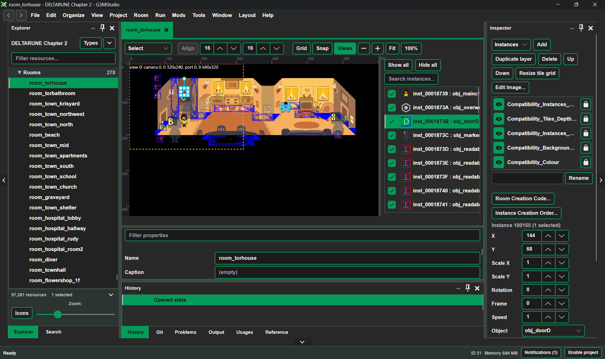

# Room editor canvas

The room canvas is the picture at the top of a room tab. This page lists the toolbar, the mouse actions and the keys that work on it.

## Toolbar

| Control | What it does |
| --- | --- |
| Tool box | Chooses the tool: **Select**, **Place**, **Paint**, **Erase**, **Fill**, **Rectangle**, **Pick**, **Line**, **Tile select**. The tile tools only act when a tile layer is selected. |
| **Align** | Opens a menu to align or distribute the selected instances. Needs two or more instances; the tooltip says `Select two or more instances in the room first.` otherwise. |
| Brush size | Number box, 1 to 8. Cells that Paint, Erase and Line touch around the pointer. Shown with a tile layer. |
| Auto-tile rule set | Box with **Auto-tile off** and the rule sets of the layer's tile set. See [Tiles](room-tiles.md#auto-tile-brush). |
| **Tile select** (tile menu button) | Opens the tile menu: cut, copy, paste, delete, flip and re-tile. See [Tiles](room-tiles.md). |
| Grid W, Grid H | Grid cell size, 1 to 4096. Shown as tooltips `Grid W` and `Grid H`. |
| **Grid** | Toggle button, key `G`. |
| **Snap** | Toggle button, key `Shift+G`. |
| **Views** | Toggle button, key `V`. Shows the view cameras. |
| Zoom out, Zoom In | Zoom steps of 0.8 and 1.25. Keys `Ctrl+-` and `Ctrl++`. |
| **Fit** | Fits the room to the canvas, key `Ctrl+0`. |
| **100%** | Actual size, key `Ctrl+Shift+0`. |

The grid starts with the grid size stored in the room. With **Settings** > **Use one grid for every room** the grid size of Settings is used instead. See [Settings](../settings/README.md). A grid size you type in the toolbar stays for that tab until the setting changes.

Zoom runs from 6.25% to 3200%. **Fit** never goes above 800%, so a small room is not blown up. The zoom, the position, the grid size and the Grid and Snap states of each room are saved with the project view and come back when the room is opened again.

## Place tool

The Place tool puts an object instance or a sprite element where you click. Select an object or a sprite in the Explorer first. The hint beside the toolbar reads `Click in the room to place {name}.` or `Select an object or a sprite in the Explorer, then click in the room.` An object adds an instance to the first instance layer. A sprite adds a sprite element named `graphic_1`, `graphic_2` and so on on the first asset layer.

You can also drag an object or sprite from the Explorer onto the canvas.

Messages: `This room has no instance layer. Add one in the layers panel first.` and `This room has no asset layer. Add one in the layers panel first.`

## Mouse

| Action | Result |
| --- | --- |
| Click an element | Selects it. |
| `Shift`+click | Adds to the selection. |
| `Ctrl`+click | Toggles the element in the selection. |
| Click empty space, drag | Draws a selection rectangle (marquee). |
| Drag selected elements | Moves them. A plain click on one of several selected elements keeps the group for a drag and narrows to that element when released without moving. |
| Drag a corner or edge handle | Scales the selected instances. `Shift` keeps the ratio, `Alt` scales from the centre. |
| Drag the round handle above the box | Rotates the selected instances in whole degrees. With **Snap** on or `Shift` held, in steps of 15 degrees. |
| `Alt`+drag from an instance | Paints copies of that instance along the path. One undo step. |
| Drag a view outline | Moves or resizes that view's camera (the view must be enabled in the room). |
| Middle button drag, or `Space` and drag | Pans. |
| Wheel | Scrolls up and down. `Shift`+wheel scrolls sideways. A horizontal wheel or a touchpad swipe pans sideways. `Ctrl`+wheel zooms at the pointer. |
| Drag from a ruler into the room | Adds a guide line. |
| Right click a guide line | Removes it. |
| Right click elsewhere | Opens the context menu. |

Guide lines are part of the view only. They are not stored in the room.

Moving, scaling, rotating and the other gestures are each one undoable edit. Handles appear only with the **Select** tool.

## Keys

The canvas must have focus (click it).

| Key | Action |
| --- | --- |
| Arrow keys | Move the selection by 1 pixel, or by one grid cell with **Snap** on. `Shift` multiplies the step by 8. |
| `Delete` | Delete the selection. |
| `Ctrl+C` | Copy the selected instances. Copies are kept per open data file, so they paste into another room of the same file. |
| `Ctrl+V` | Paste at the pointer, snapped to the grid. `Shift` pastes at the whole pixel. |
| `Ctrl+D` | Duplicate the selection with an offset of one grid cell (16 pixels with Snap off). The copies become the selection. |
| `Ctrl+A` | Select every unlocked, visible element. |
| `X` | Flip the selected instances horizontally (without Ctrl). |
| `Y` | Flip the selected instances vertically (without Ctrl). |
| `F` | Focus the view on the selection. |
| `Escape` | Clear the selection. |
| `G`, `Shift+G`, `V` | Grid, snap, views. |
| `Ctrl++`, `Ctrl+-`, `Ctrl+0`, `Ctrl+Shift+0` | Zoom in, zoom out, fit, 100%. |
| `P` (hold) | Pick through locks while no tile layer is selected: locked layers can be selected. |
| `Ctrl+F12` | Go to Object: opens the object of the selected instance in a tab. |
| `Alt+Shift+F12` | Go to Sprite: opens the sprite of the selected instance or element, or the tile set or sprite of the selected layer. |

With a tile layer selected, the letters `B`, `E`, `G`, `R`, `P`, `L`, `S`, `X`, `Y`, `Z` act on tiles instead. See [Tiles](room-tiles.md#keys).

## Context menu

Right click the canvas. The menu shows only entries that apply.

- **Duplicate (Ctrl+D)**, **Select all of this object**, **Edit Creation Code** (one instance), **Delete**.
- With two or more instances: the align items (see below).
- With a tile layer: the tile menu.
- **Edit Image...** when the selection has a picture.
- **Go to Object** (`Ctrl+F12`) and **Go to Sprite** (`Alt+Shift+F12`), only the ones that apply, then a separator and the resource commands (Rename, Duplicate Resource and so on). **Go to Object** needs exactly one instance. **Go to Sprite** works for one instance or sprite element, and with nothing selected it opens the tile set or sprite of the layer you are painting or have selected. If nothing applies the notice is `Nothing here to go to.`

### Align menu

**Align left**, **Align centers**, **Align right**, **Align top**, **Align middles**, **Align bottom**, and with three or more instances **Distribute horizontally** and **Distribute vertically**. Each is one undo step.

## Editing speed

A move, turn, scale, flip, add or delete of instances, a tile stroke, and a change of a layer's visibility or depth redraw only the part that changed. The room picture is not built again, so these edits stay quick in rooms with thousands of instances or large tile layers. Undo and redo use the same path.

The whole room is built again instead when:

- the edit changed which sprite an instance draws, so it needs a different number of pictures;
- a texture page that the change needs is not decoded yet, which can happen right after the room opens;
- several undo or redo steps arrive at once, so the change cannot be mapped to one edit.

Nothing looks different when this happens. A large room can pause briefly while it is drawn again.

## Selecting through layers

Layers can be locked with the lock icon in the layers panel. Locked elements are skipped by clicking, the marquee and `Ctrl+A`. Individual elements can be hidden in the element list. Both are view settings only. See [Layers](room-layers.md) and [Instances](room-instances.md#element-list).

## See also

- [Rooms](rooms.md)
- [Layers](room-layers.md)
- [Instances](room-instances.md)
- [Tiles](room-tiles.md)
- [Guide: make an object and place it in a room](guide-object-in-room.md)
