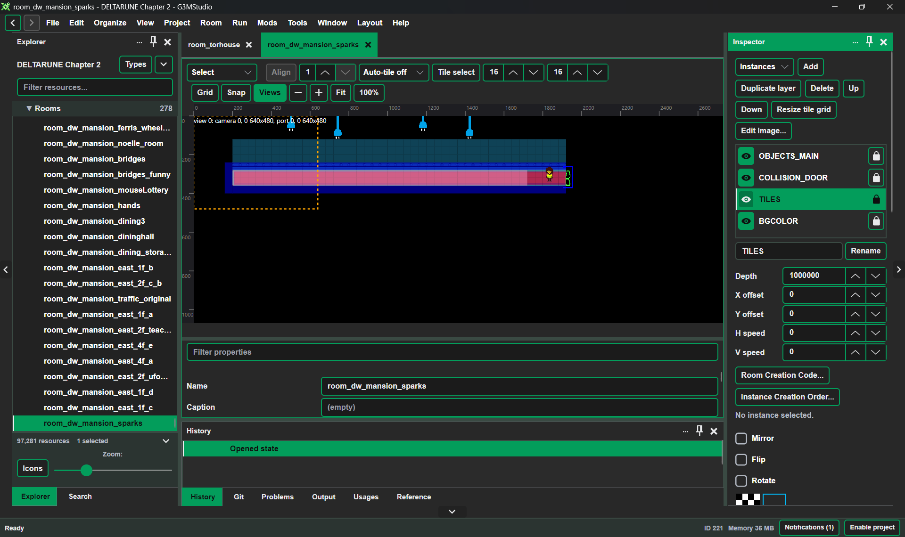

# Room layers

A GameMaker room is built from layers drawn on top of each other. This page covers the layers panel in the Inspector while a room tab is in front. Rooms from GameMaker Studio 1 have no layers and no panel.

## The list

The list shows the layers of the room, closest to the viewer first (lowest depth on top). Each row has:

- an eye toggle (tooltip **Show**) that turns the layer on or off in the room file (the layer's visible flag, one undo step);
- a lock toggle (tooltip **Lock**) that stops the canvas from picking elements of that layer. This is a view setting. It is not saved in the data file and is lost when the tab closes;
- the layer name. Hovering a row shows the kind of the layer: **Instances**, **Assets**, **Background**, **Tiles**, **Path**, **Effect**.

Drag a row onto another row to move the layer there. The depths of the layers involved change, as one undo step.

Selecting a row shows that layer's elements in the [element list](room-instances.md#element-list), and for a tile layer shows the tile palette.

## Buttons

| Button | What it does |
| --- | --- |
| Kind box | The kind of layer the next **Add** makes: **Instances**, **Assets**, **Background**, **Tiles**, **Path**, **Effect**, **UI layer**. |
| Tile set box | Appears with **Tiles**. Lists tile sets that have a tile size and tiles. Needed to add a tile layer. |
| Effect box | Appears with **Effect**. Choices: `_filter_blur`, `_filter_tint`, `_filter_vignette`. |
| **Add** | Adds a layer of the chosen kind. It also opens a grid of kinds; clicking one adds that kind. |
| **Duplicate layer** | Copies the selected layer. |
| **Delete** | Deletes the selected layer. |
| **Up**, **Down** | Swap the depth of the layer with its neighbour. Equal depths are pulled apart by 1. |
| **Resize tile grid** | Resizes the tile grid of the selected tile layer to cover the room. |
| **Edit Image...** | Opens the picture of the layer, or of the selected instance or sprite element, in the image editor. Disabled with a reason in the tooltip when there is none. |

Keys in the list: `F2` moves focus to the name box, `Delete` deletes the layer. The list's context menu has **Rename (F2)**, **Duplicate layer**, **Edit Image...** and **Delete**.

## Names, depth and defaults

- A new layer is named after its kind (`Instances`, `Assets`, `Background`, `Tiles`, `Path`, `Effect`). If the name exists, `_1`, `_2` and so on are added.
- A new layer is placed in front of all others: 100 below the smallest depth, never below -16000. Depth is limited to -16000 to 16000.
- A duplicate is named after the source with `_copy` (then `_copy2` and so on) and put 1 in front of the source.
- A layer name must be unique in the room. Renaming to an existing name fails.
- Deleting an instance layer also removes its instances from the room's instance list. Undo restores them.
- A **Path** layer on a game made with GameMaker 2022.1 or later is stored as a path layer of the newer kind.
- **Effect** layers start enabled with the chosen effect type.
- **UI layer** adds a UI layer to the data file, not to the room. UI layers are shared by all rooms and are edited in their own tab. New ones are named `UILayer`, `UILayer_1` and so on. See [UI layers](../graphics/ui-layers.md).

## Layer fields

Under the list are number boxes for the selected layer. Each change is one undo step.

| Field | Increment | Format |
| --- | --- | --- |
| **Depth** | 1 | whole number |
| **X offset** | 0.5 | up to 3 decimals |
| **Y offset** | 0.5 | up to 3 decimals |
| **H speed** | 0.5 | up to 3 decimals |
| **V speed** | 0.5 | up to 3 decimals |

The name box with the **Rename** button below renames the layer. A background layer or an effect layer also shows its data (sprite, colour, stretch, effect settings and so on) in a property list under the fields. See [Generic property list](property-grid.md).

## See also

- [Rooms](rooms.md)
- [Room editor canvas](room-canvas.md)
- [Instances](room-instances.md)
- [Tiles](room-tiles.md)
