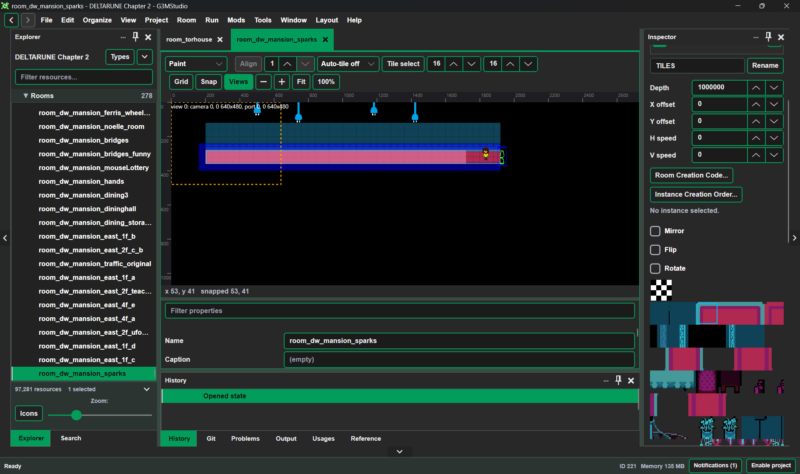

# Room tiles

A tile layer holds a grid of tiles taken from a tile set. This page covers the tile tools, the palette, the auto-tile brush, CSV export and import, and conversion of a picture to a tile layer.

## Start painting

1. In the layers panel select a tile layer. If the room has none, choose **Tiles** in the kind box, pick a tile set, and press **Add**.
2. The palette of that tile set appears in the Inspector. Click a tile in it. Index 0 is the empty tile.
3. Choose **Paint** in the tool box (or press `B`) and click or drag on the canvas.

Painting changes only the selected tile layer. With a layer that is not a tile layer selected, the tile tools do nothing.

## Palette flags

Three check boxes above the palette set flags that go on every tile you paint: **Mirror**, **Flip**, **Rotate**. The flags are stored in bits 28 to 30 of the tile value. A tile stored in the file is `index` in the low 19 bits plus the flags.

## Tools

| Tool | Key | Result |
| --- | --- | --- |
| **Select** | | The normal instance selection. |
| **Place** | | Places objects and sprites (see [canvas](room-canvas.md#place-tool)). |
| **Paint** | `B` | Sets the chosen tile on the cells you drag across. |
| **Erase** | `E` | Empties the cells. |
| **Fill** | `G` | Replaces the connected area of equal cells with the chosen tile. |
| **Rectangle** | `R` | Fills a dragged rectangle. |
| **Pick** | `P` | Chooses the tile and flags under the pointer in the palette. |
| **Line** | `L` | Paints a straight line. |
| **Tile select** | `S` | Selects a rectangle of cells. |

Brush size (1 to 8) applies to Paint, Erase and Line. `X`, `Y` and `Z` switch the **Mirror**, **Flip** and **Rotate** flags. These letter keys work while a tile layer is selected and the canvas has focus; without Ctrl or Alt.

A single stroke or fill may change at most 4,000,000 cells. Beyond that G3MStudio shows `Too many tiles at once: one stroke or fill changes at most {count} cells.` and changes nothing. Each stroke is one undo step.

## Keys

| Key | Action |
| --- | --- |
| `Ctrl+C` | Copy the selected cells. |
| `Ctrl+X` | Cut the selected cells (copy then clear). |
| `Delete` | Clear the selected cells. |
| `Ctrl+V` | Start pasting: the block floats at the pointer. Click to put it down. |
| `X`, `Y` on a floating block | Flip the block horizontally or vertically. |
| `Escape` | Drop the floating block, or clear the cell selection. |

The tile menu button (labelled **Tile select**) in the toolbar has the same actions: **Cut tiles (Ctrl+X)**, **Copy tiles (Ctrl+C)**, **Paste tiles (Ctrl+V)**, **Delete tiles (Delete)**, **Flip tiles horizontally**, **Flip tiles vertically**, **Re-tile selection**. Most are disabled until cells are selected or something was copied. The copied block is kept for the tab.

## Auto-tile brush

An auto-tile rule set turns Paint, Erase, Line, Rectangle and Fill into terrain edits: the tile for each cell is picked from its neighbours. Rule sets belong to a tile set and are created in the tile set editor. See [Auto tiles](../graphics/auto-tiles.md).

- Choose a rule set in the rule box of the toolbar. **Auto-tile off** turns the brush off.
- **Room** > **Toggle Auto-Tile Brush** turns it off, or on with the first rule set of the tile set. If there is none, the notice `This tile set has no auto-tile rule set. Create one in the tile set editor.` appears. With no tile layer: `Select a tile layer with a tile set first.`
- **Room** > **Re-Tile Selection** (or **Re-tile selection** in the tile menu) recomputes the terrain cells inside the cell selection with the active rule set, or the first one of the tile set. Without a selection or rule set: `Select tiles on a tile layer that has an auto-tile rule set first.`
- Settings: **Auto-tile** group with **Treat the layer edge as terrain**, **Layout of a new rule set (0 = 47 tiles, 1 = 16 tiles, 2 = 256 masks)** and **Choose the first rule set of a tile set when its layer is selected**. See [Settings](../settings/README.md).

## CSV export and import

**Room** > **Export Tiles as CSV...** writes the selected tile layer: one line per row, cells separated by commas, each cell the tile value (0 is empty, flags are part of the number). The notice reads `Tiles of {layer} in {room} were saved to {path}.`

**Room** > **Import Tiles from CSV...** reads such a file. It must have the same number of rows and columns as the layer and only whole non-negative numbers. Cells that differ are changed as one undo step: `Tiles changed in {layer}: {count}.` Otherwise: `The tile CSV was not used: {reason}` with a reason such as `The CSV has {n} rows; the layer has {m}.` or `Row {r}, column {c}: '{text}' is not a tile value.`

Both commands need a tile layer selected, else `Select a tile layer with a tile set first.`

## Convert Image to Tile Layer

**Room** > **Convert Image to Tile Layer...** makes a new tile layer from a picture.

1. Choose **Choose image...** and pick a picture.
2. Pick the **Tile set** (only tile sets with a picture are listed; with none, `The data file has no tile set with a picture.`).
3. Type a **Layer name** (default `Tiles`, made unique).
4. Read the summary: `{matched} cells match a tile. Cells with pixels that match no tile stay empty: {unmatched}.` plus the first few unmatched cells. If the picture is larger than the room: `The picture is larger than the room and is cut at the room edge.`
5. Press **OK**. The layer goes in front of the others, as one undo step.

Result notice: `Layer {layer} made from the picture: {matched} tiles placed, {unmatched} cells unmatched.`

## Resize tile grid

**Resize tile grid** in the layers panel makes the grid of the selected tile layer cover the room: columns and rows are the room size divided by the tile size, rounded up, at least 1. Existing tiles that still fit are kept.

## See also

- [Room editor canvas](room-canvas.md)
- [Layers](room-layers.md)
- [Tile sets](../graphics/tile-sets.md)
- [Auto tiles](../graphics/auto-tiles.md)
