# Graphical application

The graphical application (`G3MToolGUI.exe` on Windows, `G3MToolGUI` on Linux and macOS, version 1.0.5) is one window. You choose an operation, fill in file paths, press the run button, and read the result in the Activity panel. It runs the same G3MLib operations as the [command-line application](commands/README.md), with its own file naming rules (see [Differences from the CLI](#differences-from-the-cli)).

The window starts at 850 x 680 pixels and cannot be made smaller than 760 x 560. It has no menu bar, no keyboard shortcuts of its own, and no drag and drop: paths are typed, pasted, or chosen with **Browse** and **Add files**. Inside dialogs, `Enter` presses the default button and `Esc` the cancel button.

## Window areas

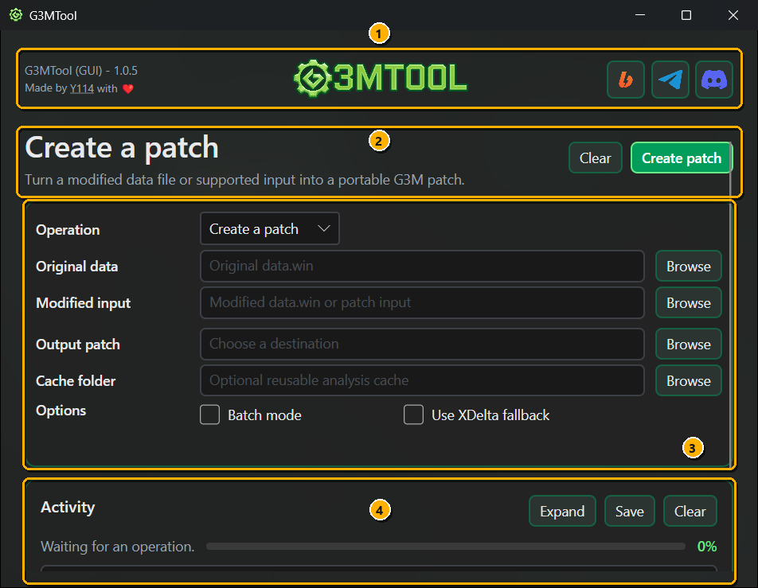

1. Top bar.
2. Page header: title, description, **Clear** and the run button (**Create patch**).
3. Operation card: **Operation** list, path fields, **Cache folder**, **Options**.
4. Activity: progress, log, **Expand**, **Save**, **Clear**.

| Area | Where | Contents |
| --- | --- | --- |
| Top bar | top | Version, credit line, logo, social buttons |
| Page header | below the top bar | Operation title, description, **Clear**, **Cancel**, run button |
| Operation card | middle | **Operation** list, path fields, **Cache folder**, **Options** |
| Activity | bottom | Progress, message, log, **Expand**, **Save**, **Clear** |

### Top bar

| Control | Behavior |
| --- | --- |
| `G3MTool (GUI) - 1.0.5` | Application version (top left) |
| **Y114** link (the line `Made by Y114 with` and a heart symbol) | Opens https://y114.space in the default browser |
| Boosty, Telegram, Discord icon buttons (top right, tooltips `Boosty`, `Telegram`, `Discord`) | Open https://boosty.to/y114, https://t.me/y_maintg, https://discord.gg/2MFdvFfD9a. If the browser cannot be started, Activity shows `Could not open link: <reason>` |

### Page header

| Control | Behavior |
| --- | --- |
| Title and description | Name and one-line description of the chosen operation (not of the batch variant) |
| **Clear** | Empties every path field, the **Cache folder**, and all options, and switches **Batch mode** off. It does nothing while an operation runs. It does not delete files and does not clear Activity |
| **Cancel** | Visible only while an operation runs. Stops it (see [Progress and cancel](#progress-and-cancel)) |
| Run button | Label depends on the operation (table below). Disabled while an operation runs |

## Operations

Pick one in the **Operation** list. Changing the operation, or switching **Batch mode**, empties the path fields and options (the **Cache folder** is kept). Only the fields that the operation uses are shown.

| Operation (title) | Run button | Original field | Main field | Additional field | Output field |
| --- | --- | --- | --- | --- | --- |
| **Create a patch** | **Create patch** | **Original data** | **Modified input** | none | **Output patch** (file) |
| **Apply a patch** | **Apply patch** | **Original data** | **Patch input** | none | **Patched data** (file) |
| **Validate a patch** | **Validate patch** | **Original data (optional)** | **Patch** | none | none |
| **Merge patches** | **Merge patches** | **Original data** | **Data output (optional)** | **Patches, low → high priority** | **Merged patch (optional)** (file) |
| **Compare files** | **Create report** | **First file** | **Second file** | none | **Markdown report** (file) |
| **Inspect a file** | **Inspect file** | none | **Data file or patch** | none | none |
| **Create XDelta patch** | **Create XDelta** | **Original file** | **Modified file** | none | **XDelta output** (file) |
| **Apply XDelta patch** | **Apply XDelta** | **Original file** | **XDelta patch** | none | **Output file** (file) |
| **Run XDelta arguments** | **Run XDelta** | none | none | **XDelta arguments** | none |
| **Run a script** | **Run script** | **Data file (optional)** | **C# script** | **Script arguments** | **Output data** (file) |
| **Run a program** | **Run program** | none | **Program** | **Program arguments** | none |

With **Batch mode** on (Create a patch, Apply a patch, Merge patches only):

| Operation | Run button | Original field | Main field | Additional field | Output field |
| --- | --- | --- | --- | --- | --- |
| Create a patch | **Create batch** | **Original data** | none | **Modified inputs** | **Output directory** |
| Apply a patch | **Apply batch** | **Original data** | none | **Patch inputs** | **Output directory** |
| Merge patches | **Merge batches** | **Original data** | **Data output directory** | **Merge sets** | **Patch output directory (optional)** |

Field rules:

- Additional fields hold one item per line, empty lines are ignored. For **Merge patches** the lines are the patches, lowest priority first, at least two. For **Merge sets**, each line is one comma-separated set, lowest priority first, at least two paths, with no comma inside a path.
- **Run a program** and **Run XDelta arguments** pass each line as one argument, with no shell interpretation and no quoting.
- **Run a script**: with a data file chosen, **Output data** is required. The script's `OutputDir` is the folder of **Output data**, and `InputDir` is the first line of **Script arguments**. A script without a data file can run without an output.
- The **Output** of **Create XDelta patch** and **Apply XDelta patch** is a file. Existing files are replaced for patch outputs; batch outputs never replace files (a `_2`, `_3`, ... suffix is added).

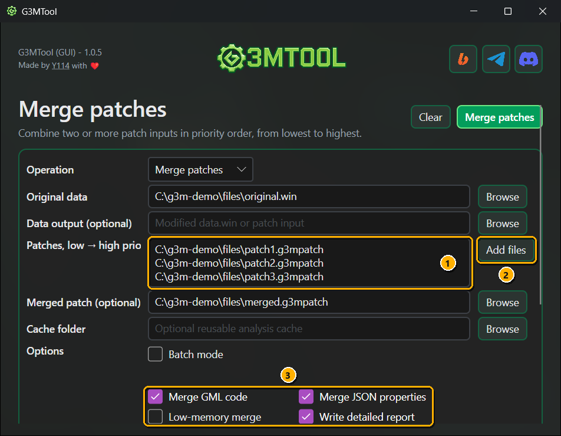

1. **Patches, low → high priority**: one patch per line, lowest priority first.
2. **Add files** appends chosen files to this field.
3. Merge options: **Merge GML code**, **Merge JSON properties**, **Low-memory merge**, **Write detailed report**.

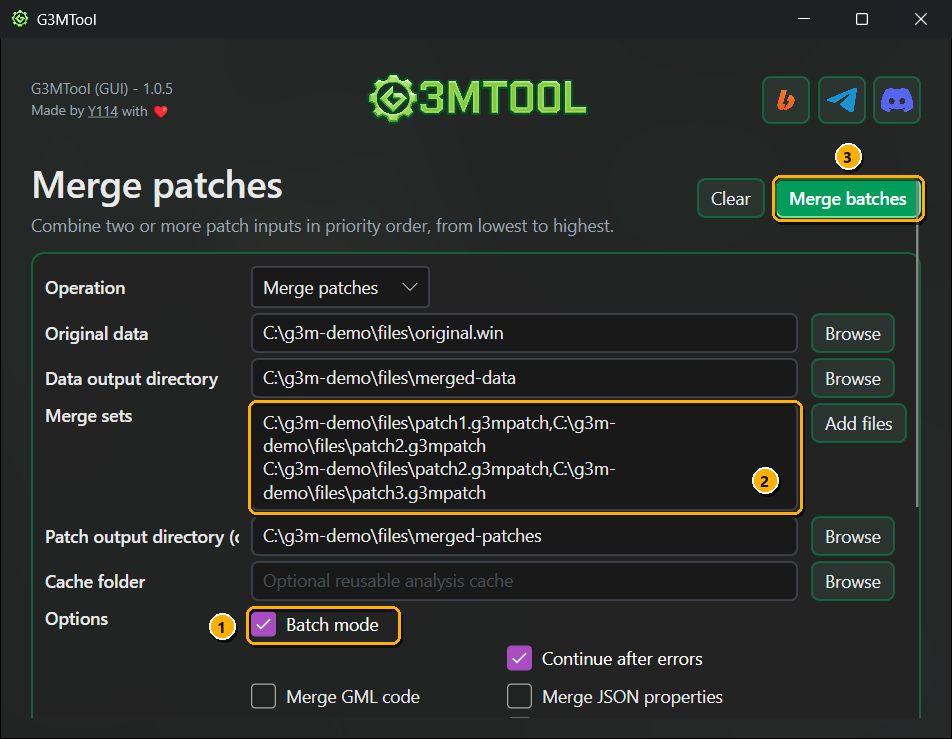

1. **Batch mode** is checked.
2. **Merge sets**: one comma-separated set per line.
3. The run button now reads **Merge batches**.

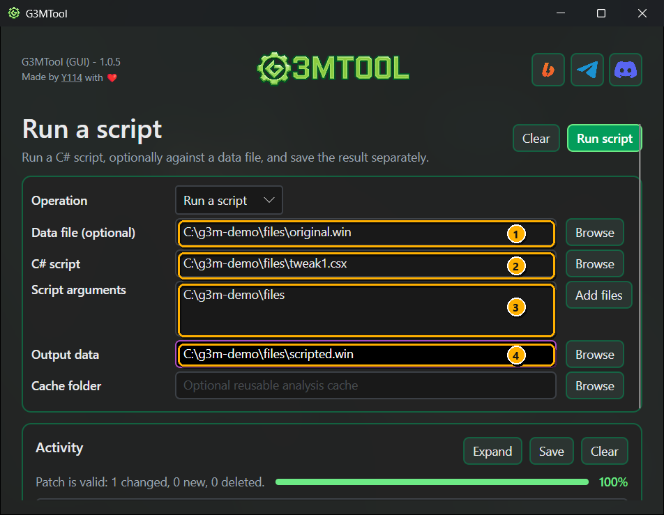

1. **Data file (optional)**.
2. **C# script**.
3. **Script arguments**: the first line becomes `InputDir`.
4. **Output data**.

Placeholders in the empty fields are fixed hints: `Original data.win`, `Modified data.win or patch input`, `One file per line; lower priority first`, `Choose a destination`, `Optional reusable analysis cache`.

### Options

Checkboxes appear only where they apply.

| Option | Shown for | Effect |
| --- | --- | --- |
| **Batch mode** | Create a patch, Apply a patch, Merge patches | Switches to the batch variant |
| **Use XDelta fallback** | Create a patch, Apply a patch, and their batch variants | Embeds an xdelta copy (create) or tries it (apply). Same rules as `--xdelta-fallback` in [patch apply](commands/patch.md#apply) |
| **Create XDelta output** | Create patch batch | Writes `.xdelta` files instead of `.g3mpatch`. With **Use XDelta fallback** it fails: `XDelta output cannot include an XDelta fallback.` |
| **Continue after errors** | Batch variants | Runs the remaining items after a failure. Otherwise the batch stops at the first failed item |
| **Merge GML code** | Merge patches, Merge patch batches | 3-way merge of GML code |
| **Merge JSON properties** | Merge patches, Merge patch batches | Deep merge of JSON property files |
| **Low-memory merge** | Merge patches | Sequential pipeline. Fails with `Sequential merge does not support code or property merging.` if combined with the two options above |
| **Write detailed report** | Merge patches, Merge patch batches, Compare files | Merge: writes a Markdown report named `<output>.merge.md` next to the merged patch (or next to the data output when there is no patch output). Compare: full mode (text, GML, JSON differences) |

**Cache folder** (every operation): optional folder for `.g3mcache` analysis files.

### Browse buttons

All file dialogs show all files. Titles are exact.

| Field | Dialog |
| --- | --- |
| Original field | Open file, `Choose original data file` |
| Main field | Open file `Choose input file`. In **Merge patches**: save dialog `Choose merged data output`, suggested name `merged` plus the original's extension (`.win` when none). In **Merge patch batches**: folder dialog `Choose data output directory` |
| **Add files** | Open files (several), `Choose input files`. Selected paths are appended, one per line. In **Merge sets** all selected files are appended as one comma-separated line; paths with a comma or line break are refused with `Merge-set paths cannot contain commas or line breaks.`. In **Run XDelta arguments** it only logs `Enter one XDelta argument per line.` |
| Output field | Folder dialog `Choose output directory` for directory outputs. Otherwise save dialog `Choose output path` with the suggested name `output.md` (Compare), `output.xdelta` (Create XDelta), `output.win` (Apply a patch, Apply XDelta, Run a script), or `output.g3mpatch` |
| **Cache folder** | Folder dialog `Choose cache directory` |

If you cancel a dialog, the field keeps its text.

## Progress and cancel

When you press the run button, the operation card and run button are disabled, **Cancel** appears, and the bar is indeterminate with the text `Starting…` until the first progress report arrives. Then the bar shows the percentage and the text shows the current step. At the end, the text shows the result summary, the bar shows `100%` on success, and an empty bar with a dash as the percentage on failure, and Activity gets the summary and one `Output: <path>` line per written file.

**Cancel** requests cancellation and disables itself. It stops patch create, apply, validate, inspect, merge, compare, batch jobs, scripts (including a script waiting in a dialog or picker), XDelta runs, and external programs (killed together with their child processes). A half-written XDelta output is removed. Activity reports `Cancelled.` as a warning; a cancelled batch reports `Cancelled; <done>/<total> completed.` (with `; <n> failed` when some failed) and lists the files made so far.

Closing the window while an operation runs cancels it first (the text shows `Cancelling the current operation before closing…`), then the window closes.

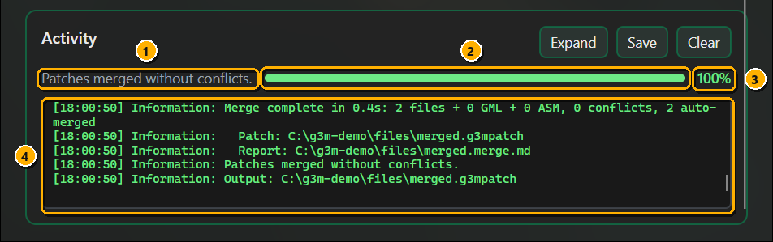

1. Progress message: the result summary.
2. Progress bar.
3. Percentage, `100%` after a success.
4. Activity log with the summary and the `Output:` line.

### Result messages

| Operation | Summary |
| --- | --- |
| Create a patch | `Patch created: <n> changed, <n> new, <n> deleted.` |
| Apply a patch | `Patch applied.` |
| Validate a patch | `Patch is valid: <n> changed, <n> new, <n> deleted.` |
| Merge patches | `Patches merged without conflicts.` or `Patches merged with <n> conflict(s); <m> resolved automatically.` |
| Compare files | `Report created: <n> difference(s).` |
| Inspect a file | DATA: `<game> · bytecode <n> · <total> resources.` and log lines `Game`, `Bytecode`, and one `<Type>: <count>` line per resource type. Patch: `Patch: <n> changed, <n> new, <n> deleted.` |
| XDelta create or apply | `XDelta patch created.` or `XDelta patch applied.` |
| Run XDelta arguments | `XDelta completed.` |
| Run a script | `Script completed.` |
| Run a program | `Program completed.`, or `Program exited with code <n>.` |
| Batches | `<done>/<total> completed; <failed> failed.` |

Validate a patch with an original data file:

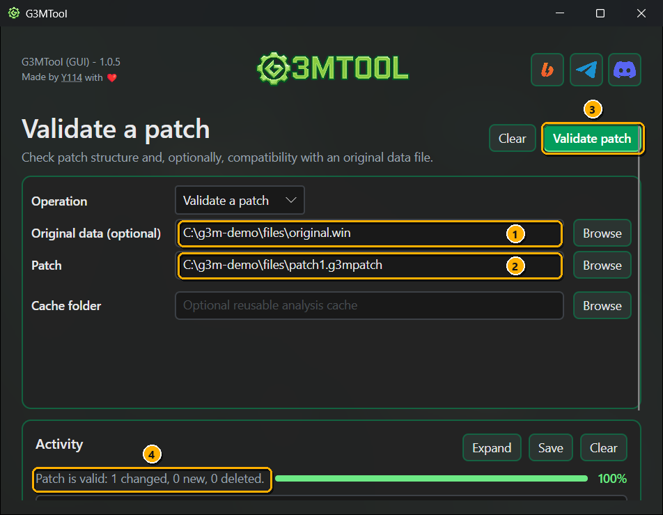

1. **Original data (optional)**.
2. **Patch**.
3. **Validate patch** run button.
4. Result summary in the progress message.

Inspect a file:

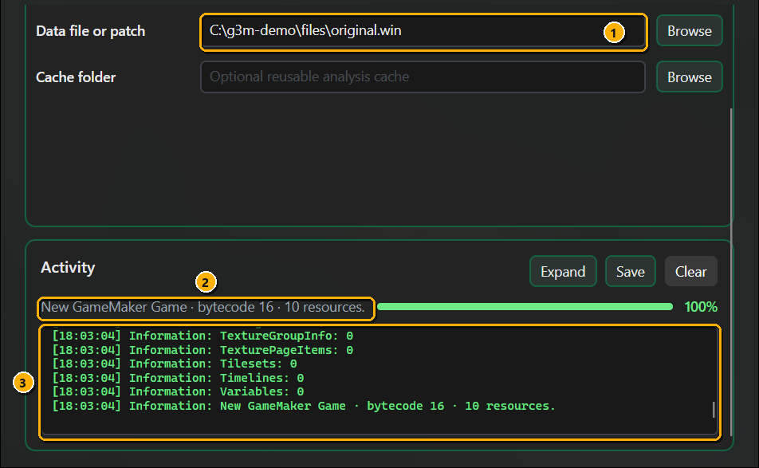

1. **Data file or patch**.
2. Result summary.
3. Activity log with the `Game`, `Bytecode` and resource type lines.

### Input checks

Shown as an error in Activity and in the progress text before anything runs:

`Original data file was not found.`, `Input file was not found.`, `Patch was not found.`, `File was not found.` (Inspect), `Script was not found.`, `Data file was not found.`, `Original data file was not found.` (Validate with a path that does not exist), `Choose an output path.`, `Choose an output directory.`, `Choose an output data path.` (script with data), `Choose at least 2 patches.`, `Choose at least 1 inputs.`, `Choose at least 1 patches.`, `File was not found: <path>`, `Enter at least one merge set.`, `Enter one XDelta argument per line.`, `Enter a program path or command name.`

## Activity

| Control | Behavior |
| --- | --- |
| Progress message, bar, percentage | Initially `Waiting for an operation.` and `0%` |
| **Expand** / **Collapse** | **Expand** hides the top bar, page header, and operation card and enlarges the log (at least 220 pixels, about 85% of the window height). **Collapse** restores them. The log is 110 pixels high when collapsed |
| **Save** | Save dialog `Save activity log`, suggested name `g3mtool.log`. Writes the whole log text. A file that cannot be written (a read-only folder, for example) adds an Error line to the log |
| **Clear** (Activity) | Empties the log only |
| Log panel | Selectable text (copy with the system shortcut). One line per message: `[HH:mm:ss] <Level>: <message>`. Information is green, Warning amber, Error red, other levels gray |

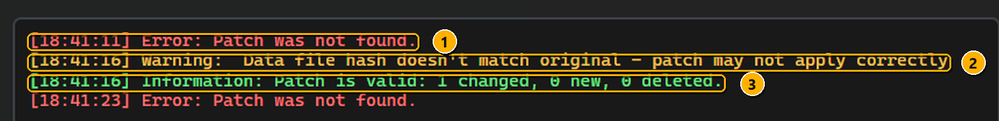

1. Error line (red): a validation of a patch that does not exist.
2. Warning line (amber): the patch does not match the chosen original data.
3. Information line (green): the patch itself is valid.

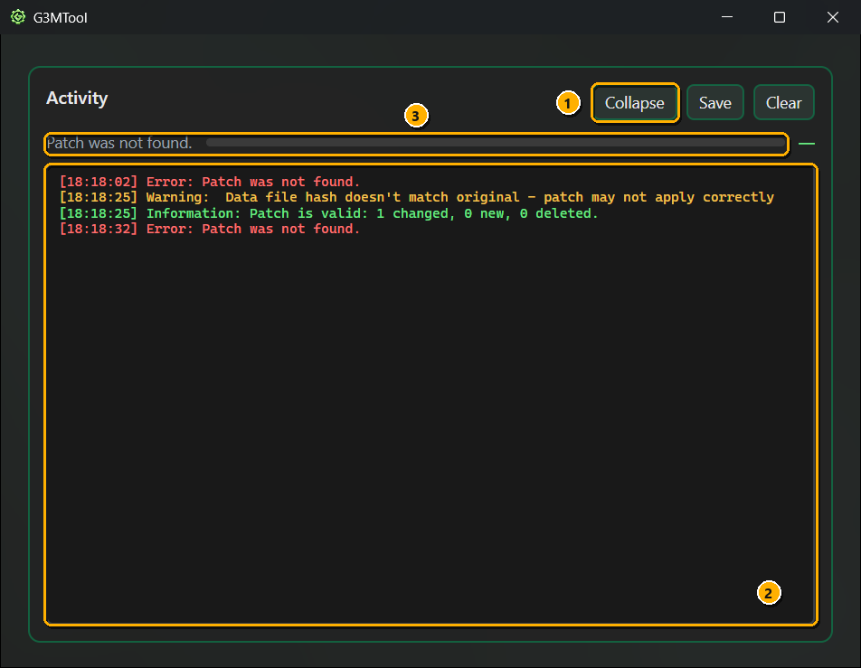

1. **Collapse** restores the top bar, page header, and operation card (the button reads **Expand** in the normal view).
2. The log fills the window.
3. Progress message and bar stay visible.

The log keeps up to 1,000,000 characters. When it grows past that, the oldest lines are removed until it is at 80% of the limit. The GUI logs in verbose mode, so it shows more library messages than the CLI does by default.

## Scripts and dialogs

**Run a script** runs the script on a background thread, so the window stays responsive. There is no timeout; use **Cancel**. Console and `ScriptMessage` output appears in Activity as `[Script] <text>`, warnings as warnings. Script dialogs open over the main window:

| Script call | Dialog |
| --- | --- |
| `ScriptQuestion` | Title `Script question`, the message, buttons **No** (Esc) and **Yes** (Enter). Yes returns true, No returns false |
| `ScriptInputDialog`, `SimpleTextInput` | Title and label from the script, a text box with the default value, buttons **Cancel** and **OK** (the button texts the script passes are not used). Cancel returns null. Multi-line input gives a resizable dialog with a taller box |
| `PromptLoadFile` | Open dialog `Open script file`, one file, with the script's filter |
| `PromptSaveFile` | Save dialog `Save script file`, with the script's filter |
| `PromptChooseDirectory` | Folder dialog `Choose script directory` |

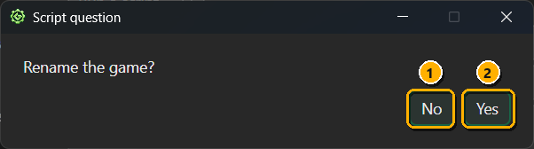

1. **No** (`Esc`), the script gets false.
2. **Yes** (`Enter`), the script gets true.

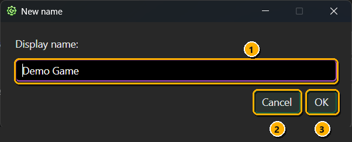

1. Text box with the default value from the script.
2. **Cancel**, the script gets null.
3. **OK**, the script gets the text.

A cancelled picker or dialog returns null to the script. The script's file filter uses the pairs `Name|*.ext;*.ext2|Name2|*.ext3`; without a usable filter all files are shown. Scripts that call `ScriptInputDialog` in the GUI therefore behave differently from the CLI, where the default is returned. See [CSX scripting](csx-scripting.md).

## Differences from the CLI

| Topic | GUI | CLI |
| --- | --- | --- |
| Compare output | A report file path you choose | A folder; the file is named `diff_<timestamp>.md` |
| Merge report | `<output>.merge.md`, only with **Write detailed report** | `<output>.merge_log.md`, also written when conflicts exist, or any path with `--report` |
| Batch merge names | `merge_<nn>` (two digits) | `merge_<nnn>_<input names>` |
| Merge without any output | Merged patch next to the original DATA file, named `merged_<yyyyMMdd_HHmmss>.g3mpatch` | The same |
| Script timeout | none | `--timeout` |
| Script questions and inputs | Dialogs | Answered yes or default |
| Logging | Verbose, shown in Activity | Quiet unless `--verbose` |

## Which operation to choose

| I want to | Choose |
| --- | --- |
| Make a patch from two DATA files | **Create a patch** |
| Make one patch per modified file | **Create a patch** with **Batch mode** |
| Check that a patch matches my DATA | **Validate a patch** with **Original data (optional)** filled |
| See what is inside a DATA file or patch | **Inspect a file** |
| Combine several mods | **Merge patches** (lowest priority first) |
| Export or import resources with a script | **Run a script** |
